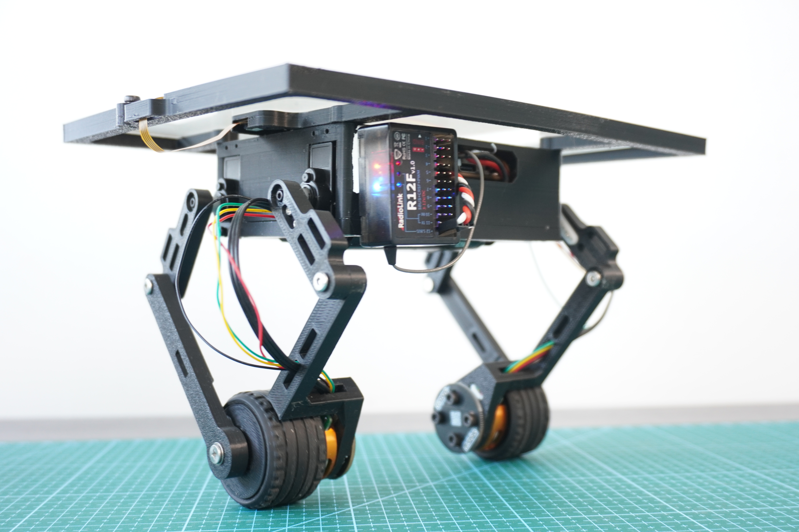
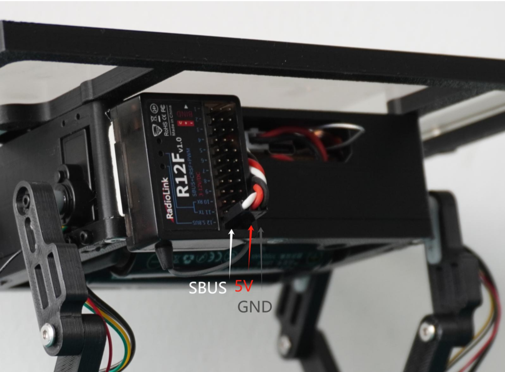
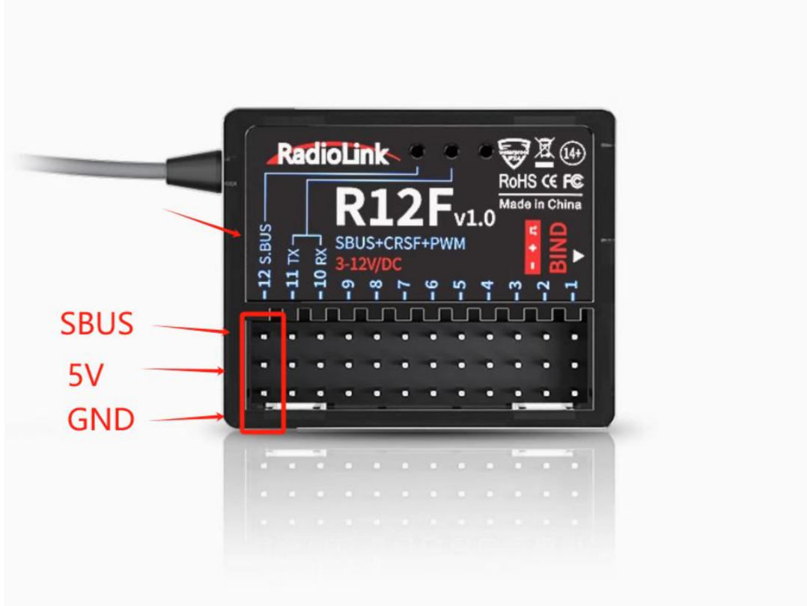

# Navbot-ES02 - Open Source Desktop Dual-Wheel Legged Robot



**Navbot-ES02** is a compact, open-source desktop robot that combines self-balancing wheels with articulated legs. It’s an experimental platform for exploring locomotion, balance, and user interaction — ideal for makers, educators, and robotics enthusiasts.

Full tutorial: [Frank Fu’s Build Guide](https://frankfu.blog/embodied-ai-robot/diy-desktop-dual-wheel-legged-roboy/)

---

##  Key Features

-  **Self-balancing** using an ICM-42688 IMU and PID control
-  **Legged motion** using 270° digital servos
-  **Radiolink T12D RC System** for real-time operation switching via PWM/SBUS.
-  **Modular Arduino-based firmware** for easy customization

---

## Hardware Overview

| Component      | Description                                   |
|----------------|-----------------------------------------------|
| **MCU**        | ESP32-S3 DevKit                               |
| **Motors**     |  2208 90KV 3mm Shaft Gimbal Brushless Motors            |
| **IMU**        |  ICM42688 a 3-axis gyroscope and a 3-axis accelerometer            |
| **Servos**     | Pro-Tronik PTK 7452 MG-D 2.8kg/0.11s 12.3g Micro Digital Servo     |
| **Battery**    | 2Pcs 18650 Battery Charger Pack              |
| **Controller**    | Radiolink T12D 12CH 2.4G RC Transmitter R12F Receiver                     |

---


## Repository layout

| Folder | Content |
| --- | --- |
| `src/` | Robot firmware (`src/ES-02/OllieFOCdrive/`), ros2_pc software (`src/ros2_pc/`), and the shared link protocol (`src/navbot_link/`) |
| `scripts/` | Host tools for building, capturing, and analysing |
| `tests/` | Host tests |
| `cad/` | PCB project, 3D-print and CAD files |
| `docs/` | Documentation of the current state and plans |
| `lab/` | Dated observations and raw captures |

The full placement rules are in [AGENTS.md](AGENTS.md#where-files-go). The current firmware supports the two-wheel balancing robot only. Legacy four-wheel gait control and master/slave communication have been removed. UART2 handles SBUS.

## Project documentation

- [Robot documentation](docs/robot/README.md): ESP32 hardware, firmware, control, diagnostics, and roadmap.
- [ros2_pc documentation](docs/ros2_pc/README.md): onboard computer, attached sensors, ROS 2 software, and roadmap.

## Getting Started

### 1. Install Requirements

- Arduino CLI with the ESP32 board package installed
- Libraries (via Library Manager or GitHub):
  - [SimpleFOC](https://github.com/simplefoc/Arduino-FOC)
  - [SimpleFOcDrivers](https://github.com/simplefoc/Arduino-FOC-drivers)

The repository does not pin the ESP32 core or Arduino library versions. The build uses the versions installed in your Arduino CLI environment.
Used library versions are recorded per build in firmware-build-environment.json.
    
### 2. Build and flash the firmware

```bash
git clone https://github.com/fuwei007/Navbot-ES02.git
cd Navbot-ES02
python3 scripts/build_firmware.py
```

The command builds the NavBot sketch into `build/flash`. Run `python3 scripts/build_firmware.py --help` to choose another sketch, board, output directory, or build properties. To flash a compiled build, use the configured `navbot_flash` MCP tool `flash_firmware` with the absolute build directory from the active worktree. Check the serial MCP `list_ports` before reporting that the board is disconnected, close the serial MCP connection before flashing, and keep balance disabled with motor outputs safe. See the [canonical USB/serial documentation](docs/robot/software/usb-serial-flashing.md) for board settings and verified connection details.

### Sensor diagnostics, trace capture, and live tuning

See the [trace capture guide](docs/robot/software/trace-capture.md) and the [sensor diagnostic guide](docs/robot/software/sensor-diagnostic-mode.md).

### 3. Connect the model remote control
ES02 has 3 lines, namely GND, 5V, and sbus.



The remote control receiver may have multiple interfaces. It is necessary to confirm the sbus
output port by yourself. The following picture shows the wiring ports of the RadioLink receiver.



The channels of the joystick are generally defaulted to ch1-4. Besides, six auxiliary channels
are needed to switch on some functions. Each remote control is different, and they should be set
according to personal habits. The corresponding functions of ch6-10 can be referred to as follows:

The firmware's channel assignment for CH1 to CH10 is in the [RC channel map](docs/robot/software/rc-channel-map.md).

---

## Tourial Videos

- DIY ES02 Desktop dual-wheel legged bot Preview:
  
  [](https://www.youtube.com/watch?v=u7Jmyq_AXwc)


- Open Source ESP32 DIY Robot ES02: Learn Coding & Robotics | Educational Dual-Wheel Legged Bot:
  [](https://www.youtube.com/watch?v=hujr_VRSyrw)

---

## Discord link
| Link: [https://discord.gg/syywQ2CKN3](https://discord.gg/syywQ2CKN3)        |
| :------------: |
|  |

---

## Acknowledgments

- [SimpleFOC Community](https://simplefoc.com/)
- [Frank Fu’s Robotics Blog](https://frankfu.blog)
- [LVGL GUI Library](https://lvgl.io/)
- Arduino & ESP32 Open Source Communities

---

> Feel free to fork, contribute, or build your own version!  
> PRs and feedback are always welcome.
