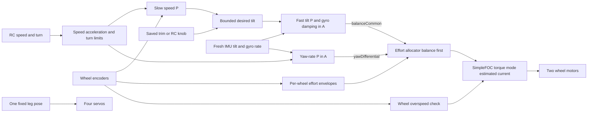

# Robust standing and driving control

Status: Packages 1 to 3 carry their own status lines below, and Package 4 (the controller module) is implemented and described in [Balance controller](../software/balance-controller.md). Packages 5 to 7 have no status recorded yet, and Package 8 (documentation) is under way. Prepared on 2026-10-22 against source revision `ba1a36b16b979fe4ed94c41ac580a77a72c3da2b`.

The user reports that the ROS 2 PC and rotating LiDAR are now mounted on the robot. The immediate goal is reliable standing and low-to-medium-speed driving with that complete payload. Manual payload-balance trim must work through either an RC knob or a saved constant. This proposal replaces coupled actuator paths with one explicit control chain and a staged tuning procedure.

In short:

1. Hold the legs in one fixed pose. Driving no longer moves the legs.
2. A slow speed loop requests a small tilt. A fast balance loop commands wheel current directly (SimpleFOC torque mode): tilt P for stiffness, gyro rate for damping. A yaw-rate loop adds differential current.
3. One allocator splits common and differential current inside measured per-wheel limits, with balance first.
4. One trim angle, set at standstill by knob or constant, compensates fore/aft payload offset.
5. Measure LiDAR vibration before choosing any filter.
6. Commission in eight supported stages, each with a pass gate, before free standing or driving.

## Why the present system is difficult to tune

The current source has several paths that affect the same physical motion:

| Observed behavior | Consequence for tuning | Source |
| --- | --- | --- |
| Speed PI changes `bodyX`, which changes the leg IK targets. Balance PID independently changes wheel velocity targets. | Driving changes both body geometry and wheel action. Servo lag, payload position, and balance tuning interact. | `runPostureController()` and `writeLegServos()` in the [sketch](../../../src/ES-02/OllieFOCdrive/OllieFOCdrive.ino). |
| A braking-only wheel-speed correction is added alongside balance and yaw. | Wheel-speed feedback has two actuator paths. | `runPostureController()`. |
| The balance PID sends tilt error to wheel velocity with P 5, I 200, D 0.11, and a stored-integral limit of 0.1 in the selected preset. | In a velocity cascade the tilt integral supplies the restoring stiffness (see [below](#why-not-a-velocity-command-balance-law)). The 0.1 limit caps that term at 20 wheel rad/s, beyond which the loop behaves as P+D only, which is unstable in the simple model. Stiffness, drift correction, and windup share one clamped state. | Sketch presets and `runPostureController()`; the former `MyPIDController`. |
| Wheel targets are clipped individually after mixing. | Steering can consume balance headroom; clipping changes the intended common/differential mix. | End of `runPostureController()`. |
| Control runs after an elapsed-time threshold of 1 ms. IMU reads are data-ready gated, with coefficients designed for nominal 1 kHz. | Sensor ODR, accepted-read rate, control rate, and filter design rate need separate verification. | [IMU implementation](../../../src/ES-02/OllieFOCdrive/imu.cpp), [IMU settings](../../../src/ES-02/OllieFOCdrive/imu.h), sketch `loop()`. |
| Wheel-speed differentiation uses measured time only with the diagnostic-defaults define enabled. | Gain comparisons across build settings can have different measurement scales. | `updateWheelVelocities()`. |

The [control-flow explanation](../software/control-flow.md) contains older details. In the inspected source, the wheel motion mode is `velocity`, the torque mode is `estimated_current`, phase resistance is configured as 22 ohms, and IMU low-pass defaults are 25 Hz. The older page describes voltage torque mode and earlier IMU behavior. The source establishes configuration; the flashed image and live values still need reconciliation before experiments.

## Recommended control chain

Keep the four leg servos in one fixed pose during standing and driving: all joint angles at 0, the calibrated servo-zero position, if stage 1 confirms that this pose is mechanically suitable (see [Decisions](#decisions)). Hold leg height, fore/aft position, and lateral posture constant. Remove touch/ball/posture contributions and the parallel speed-to-leg and braking-only wheel paths from the replacement control path. This also removes the roll PID that levels the body laterally through leg height; on uneven ground the chassis follows the floor. Do not retain an alternate old controller for compatibility.



The speed controller asks for a small lean correction. The balance controller uses measured tilt and angular rate to request a common wheel current `balanceCommon` in amperes. Gyro-rate damping replaces numerical differentiation of the tilt error. Yaw-rate P requests a differential current `yawDifferential`. Start with no balance integral and no yaw integral. Add a small speed integral only after proportional control works and sustained speed bias remains. Remove the sign-dependent `controlTorqueCompensation` offset from the replacement wheel-target calculation; no hidden sign or offset path may remain in the balance output.

### Direct effort instead of a wheel-velocity loop

The current balance output goes to SimpleFOC's wheel-velocity interface, which runs a speed regulator inside the motor stage. The replacement sends the balance output directly as a torque-mode target: `MotionControlType::torque` with `TorqueControlType::estimated_current`, in amperes. The official [SimpleFOC torque-loop documentation](https://docs.simplefoc.com/torque_loop) defines the current/voltage target units; the [velocity documentation](https://docs.simplefoc.com/velocity_loop) describes the nested interface removed from this balance path.

Estimated current is a command and a model value. It is computed from configured motor parameters, not from measured phase current. It is not measured torque and not hard current protection.

#### Why not a velocity-command balance law

In the point-mass model `h·θ̈ = g·θ − v̇` with ideal tracking of the commanded axle velocity `v`:

- P+D on tilt, `v = a·θ + b·θ̇`, gives `(h+b)·s² + a·s − g`. For `h+b > 0` one root is positive for every gain choice.
- PID on tilt, `v = a·θ + b·θ̇ + c·∫θ`, gives `(h+b)·s² + a·s + (c − g)`, which is stable for `h+b > 0`, `a > 0`, and `c > g`.

A velocity cascade can therefore balance, but only through its tilt integral: in that structure the integral is the restoring stiffness, not a drift corrector. The current firmware has this structure, and its integral limit removes that stiffness for larger excursions. The clamp is a candidate contributor to the reported oscillation, not a proven cause.

The replacement uses torque mode because:

- its gains act on tilt directly (P is stiffness, gyro gain is damping), instead of stiffness living in an integrator state whose clamp, reset, and windup interact with drift, trim, and the speed loop;
- the per-wheel effort limit is explicit in the allocator instead of hidden inside SimpleFOC's velocity PI;
- both interfaces end at the same voltage ceiling ([Available current](#available-current)), so velocity mode offers no extra authority.

The cost is that torque mode has no inner speed limit. Wheel speed is bounded only by the balance law, the speed loop, and the wheel overspeed check.

#### Coupled torque model

A wheel-driven body also receives the motor's reaction torque, so acceleration is not a fixed scale factor from commanded current. Use an explicitly coupled small-angle model around the loaded equilibrium. Let `m` be body mass, `h` its centre-of-mass height, `J` its inertia about its centre of mass, `M` the effective total translating mass including wheel rolling inertia, `r` wheel radius, `x` axle position, and `u` the sum of wheel torques in N m. With forward-positive signs chosen consistently, a lossless local model is:

```text
M*x_ddot + m*h*theta_ddot = u/r
(J + m*h*h)*theta_ddot + m*h*x_ddot - m*g*h*theta = -u
D = J + m*h*h - (m*h)**2/M
A = m*g*h/D
B = (1 + m*h/(r*M))/D
theta_ddot = A*theta - B*u
u = kTheta*(theta - thetaRef) + kRate*theta_dot
inner characteristic: s*s + B*kRate*s + (B*kTheta - A)
```

For positive physical `D`, local tilt stability in this idealized model requires `B*kRate > 0` and `B*kTheta > A`. These are torque-domain gain conditions, not firmware gain values. For an equal motor pair with torque constant `Kt`, the common current request maps nominally to `u = 2*Kt*balanceCommon`; motor direction signs are applied separately. The [MIT cart-pole equations](https://underactuated.mit.edu/acrobot.html) provide the coupled-pendulum foundation; the explicit wheel reaction term and current conversion here are modeling assumptions to validate on this robot. No gear ratio is assumed for the installed drive.

This is an analytical local model, not proof for the assembled robot. Fit or bound its parameters and extend it with winding resistance/back-EMF, friction, SimpleFOC's current-setpoint low-pass filter, sensor filters, scheduling delay, supply-dependent clipping, and both motor signs. Verify:

- the sign and scale from each commanded ampere to loaded wheel acceleration and body response;
- the per-wheel effort envelope versus wheel speed and bus voltage;
- loaded inertia, centre-of-mass height, sample age, filter delay, and processing delay;
- the complete balance-plus-speed P/PI feedback model, not only the inner tilt characteristic.

Passive measurements and bounded motor identification under support precede fitting. Before the first balancing trial, assess the closed-loop model including actuator/sensor delays and confirm a supported fault action.

With the speed loop disabled, the robot does not merely drift. Unless `thetaRef` equals the true equilibrium exactly, the tilt loop settles at a constant non-zero wheel torque, which is a constant acceleration. Stage 4 therefore requires a tested wheel overspeed limit, short trials, and a bounded area. No balance integral is used in initial commissioning; recheck that choice against the measured plant.

Slow speed P (PI only after commissioning) produces the bounded tilt reference. Its loop is slower than the balance loop. The provisional response-separation objective is at least about 3-5 times between adjacent loops, confirmed by loaded measurements rather than by the ratio alone; the [MathWorks cascade example](https://www.mathworks.com/help/control/ug/tuning-multi-loop-control-systems.html) illustrates that separation. Wheel-encoder speed feeds the outer speed loop, the effort-envelope calculation, and the wheel overspeed check; it does not feed an inner velocity servo. If the effort path fails the stage 3 or stage 4 gates, stop and correct the plant measurement or actuator envelope. Returning to the velocity interface does not add authority, because both end at the same voltage ceiling.

The ESP32 owns stabilization and command timeout. Balance must continue when the PC restarts, LiDAR data stops, or ROS is busy. The inspected checkout does not establish an active ROS motion-command link. Building or merging that transport, SLAM, and navigation are outside this plan.

### Available current

The sketch configures an 8.4 V supply and voltage limit, 22 ohms phase resistance, `current_limit` 5 A, SpaceVectorPWM, and no `KV_rating`. In the installed SimpleFOC 2.4.0, estimated-current torque mode:

1. clamps the target to `current_limit`;
2. low-pass filters it (`LPF_current_q`), which adds actuator delay;
3. computes `voltage.q = current * phase_resistance + back-EMF`, where the back-EMF term is zero unless `KV_rating` is set;
4. clamps `voltage.q` to `voltage_limit`.

Consequences:

- The ceiling at standstill is at most 8.4 V / 22 ohms ≈ 0.38 A per wheel. SpaceVectorPWM can produce a phase amplitude of only about supply/√3 ≈ 4.8 V, which suggests about 0.22 A. Battery sag lowers both. The 5 A `current_limit` never binds, and the `voltage_limit` clamp does not report modulation saturation because it sits above what the modulator can produce. Verify the real ceiling in stage 3.
- Without `KV_rating`, the requested current ignores back-EMF. Actual current falls as wheel speed rises while the command stays the same, so the commanded value overstates delivered torque during driving.
- The same voltage ceiling applies in today's velocity mode. Torque mode does not lower authority; it makes the limit visible.

Before stage 3, measure phase resistance and the back-EMF constant of each motor, configure `KV_rating`, and set `current_limit` and `voltage_limit` to values the driver can actually produce, so that the clipping diagnostics are meaningful. Whether the resulting torque, about `2*Kt*0.2 A` for the pair, can hold the loaded robot is the central stage 3 gate.

## Manual payload trim

Use one parameter, `balanceTrimDeg`, as the neutral balance reference. It compensates fore/aft mass offset by allowing a small equilibrium chassis lean. It does not move the mounted mass or guarantee that the chassis remains geometrically level. A stationary robot with an offset payload can legitimately have a nonzero chassis angle while its combined centre of mass is over the wheel axle.

The conceptual law is shown below. Bound and slew-limit the combined desired tilt, including the speed correction, before evaluating the balance error:

```text
speedCorrection = speedPI(requestedSpeed - measuredSpeed)
desiredTilt = limit(balanceTrimDeg + speedCorrection)
tiltError = measuredTilt - desiredTilt
balanceCommon = tiltP * tiltError + gyroDamping * measuredBalanceRate
```

All feedback signs and axes must be physically verified. The inspected firmware calls the fore/aft balance angle `correctedRollDegrees`; a name such as `gyro.y` must not be selected merely because the new variable is called pitch. Use rad/s consistently inside the controller and convert any degree-based parameter explicitly.

Use the saved constant during normal standing and driving. The knob is a commissioning control at standstill, followed by an explicit save. It is not a continuous body-lean control during driving: once speed I restores zero speed, its steady-state correction can oppose a knob change. Expose two mutually exclusive trim sources for this procedure:

- A saved constant is the default. A compiled constant is sufficient for the first commissioning; explicit storage can then use the existing configuration infrastructure. Never write flash continuously as the knob moves.
- The CH9 knob commands the same bounded trim, and only in the standstill commissioning state. The transmitter sets CH9 between 1000 and 2000 µs, default 1500 µs; the mapping is given under [Decisions](#decisions). Start from the saved value and engage the knob only after its position matches the active trim, so enabling it cannot cause a jump. CH9 no longer drives ball X (`topBallX`); package 3 removed that use.

Start with zero trim under physical support. Estimate the loaded fore/aft offset and centre-of-mass height from the mounted components or supported equilibrium measurements; `atan(offset / height)` gives a simple rigid-body estimate of the necessary lean. An initial evaluation range of +/-0.5 degrees, steps no larger than 0.1 degrees, and a slew no faster than 0.25 degrees/s are proposed trial values, not validated safe limits. That range may be insufficient for the actual payload. Select the working range from the measured offset and recovery authority. Clamp the sum of trim and speed correction; trim must not bypass the tilt/recovery envelope or fall detector. Speed anti-windup must use the remaining tilt range after trim, as well as downstream effort limits.

Commission the trim only in the standstill commissioning state: drive request zero, yaw disabled, and speed integral disabled. Adjust it to reduce repeatable drift and the steady speed-P correction. Speed integral is not a trim tool; any residual integral present at entry is handled by the transfer below.

### Standstill commissioning transition

Speed I can be nonzero when the robot enters commissioning from RUN. Its contribution may be transferred into the working trim, which then still has to pass the save checks below. Entry uses one defined transfer, performed at a single control tick:

1. Precondition: the robot is supported, the drive request, yaw, and knob are idle, and requested speed ramps to zero at the braking envelope until measured wheel speed and tilt error are inside commissioned tolerances. There must be no active effort/tilt clipping or ongoing tilt-reference slew. If these conditions do not settle, refuse the transition and remain in RUN.
2. Keep the same speed-P gain during the transfer. Capture the pre-limit sum `θ_ref = trimWorking + speedP·e + speedI`, where `e` is the speed error at this tick. Retain the existing clamp/slew state of the actually applied tilt reference.
3. Transfer: `trimCandidate = trimWorking + speedI`. Compute the complete proposed post-transfer speed-correction clamp and combined tilt clamp without mutating state. Require `trimCandidate` inside the trim envelope and the proposed applied reference equal to the current applied reference within the commissioned numerical tolerance, without engaging a new clamp. Otherwise refuse the transition. No value changes and no jump occurs.
4. Zero and disable: set `speedI = 0`, disable speed I, and set `trimWorking = trimCandidate`. The reference becomes `trimCandidate + speedP·e`, which equals `θ_ref` at this tick, so the tilt reference does not jump.

While in commissioning, `trimWorking` changes only by slew-limited knob input or commissioning edits inside the envelope. Speed I stays zero. Enabling speed I later starts from zero at standstill as a separate tuning step.

### Saving and restart check

A save request is refused unless speed I is disabled with zero contribution at that tick, drive and yaw requests are zero, and the supported commissioning preconditions still hold. The proposed RC save trigger is a deliberate CH6 switch edge in commissioning, after verifying transmitter mapping; CH6's former posture/mark behavior is absent from the replacement path. Ignore a switch level already present at entry, so boot or mode entry cannot save accidentally.

Before saving, the working trim passes a zero-speed hold with speed I disabled, initially the 60 s stage 5 window. The save stores the value with a `validated = false` flag. Then disable, rearm, and repeat the hold with the value reloaded from storage; restart and repeat once more. This tests the stored value rather than retained RAM. Only after both holds pass does an explicit confirmation set `validated = true`. Normal RUN requires a validated trim; a failed hold leaves the robot in supported commissioning.

The firmware cannot detect a payload or leg-pose change. After either change, clear the validated flag and recommission. Normal later starts load the validated value with the usual arming checks and do not repeat the 60 s hold.

On RC loss, hold the active trim while commanding a controlled stop. Do not snap the trim to zero. When RC returns, require knob pickup against that held value before accepting knob trim again. An invalid trim value is rejected.

Keep IMU mounting calibration, gyro bias, servo assembly offsets, and payload trim separate. An angle-zero calibration is not a way to hide payload imbalance. A lateral centre-of-mass offset needs a mechanical/support-width check; this fore/aft parameter cannot correct it. If a level chassis is essential or the required trim exceeds the measured envelope, reposition the payload or evaluate a static leg-X setup adjustment. Do not add an active leg speed controller for that purpose.

## Effort allocation and limits

Use one owner for the paired wheel targets, in amperes. At each control tick, compute per-wheel effort envelopes from measured wheel speed, the bus voltage after a sag margin, the modulation limit, the effective current cap, phase resistance, and back-EMF. An envelope is invalid if either endpoint is non-finite, its lower endpoint exceeds its upper endpoint, or the inputs lie outside the commissioned model range. Its freshness is bounded by the acquisition timestamps of encoder speed and bus voltage, not merely by the envelope computation time; commissioning sets the maximum permitted ages. Any invalid or stale envelope latches the authority fault. An interval excluding zero can be valid during modeled braking at speed; it does not justify arming at rest or operation outside the validated braking model. The left envelope is `[Lmin, Lmax]` and the right is `[Rmin, Rmax]`, with the per-wheel sign applied at the hardware boundary. Commissioning supplies the constants. The formulas are not validated values.

```text
if either envelope is invalid or stale: authority fault
cMin = (Lmin + Rmin)/2
cMax = (Lmax + Rmax)/2
c = clamp(balanceCommon, cMin, cMax)
dMin = max(c - Lmax, Rmin - c)
dMax = min(c - Lmin, Rmax - c)
d = clamp(yawDifferential, dMin, dMax)
leftEffort = c - d
rightEffort = c + d
```

Derivation: `left = c − d` must lie in `[Lmin, Lmax]` and `right = c + d` in `[Rmin, Rmax]`, giving the differential bounds above. A differential exists exactly when `2*c` lies between the sums of the two lower and upper bounds, which gives `cMin` and `cMax`. This uses the full feasible common range, rather than unnecessarily limiting balance to the intersection of per-wheel intervals.

At asymmetric limits, preserving balance can force a nonzero differential even when the operator requests zero turn. That is an explicit balance-first tradeoff: requested yaw yields to recovery. Log the unavoidable differential, reduce driving demand, and validate the resulting transient under support. Insufficient reserve in otherwise valid envelopes first reduces drive and turn demand; exhausted recovery authority enters the verified fault action. Do not label a model envelope as proof that either motor can deliver it. The 88 rad/s velocity cap is not reused; motor targets in this torque mode are amperes.

Current-domain mixing assumes matched torque-per-ampere behavior. If loaded identification finds material mismatch, allocate in common torque-equivalent units using the identified per-wheel conversion, convert each feasible interval into those units before allocation, then convert the two outputs back to current targets. Otherwise equal summed current need not mean preserved summed torque.

The envelope is a model bound on requested current, not measured torque. Estimated-current limiting and voltage clipping can still reduce actual effort, and bus sag lowers the envelope. Observe commanded-versus-encoder response, clipping counters, supply voltage, and temperature. Define the voltage-clipping flag at the SimpleFOC estimated-current voltage clamp by exposing its pre-limit voltage request and applied `voltage.q`, together with the effective voltage limit; this instrumentation is part of commissioning. The final `voltage.q` alone does not establish the size of an unmet request. Also report clipping of requested current to `current_limit`. Both are model/command diagnostics and do not measure phase current. When balance needs reserve, reduce requested acceleration and yaw first, then the cruise cap. Do not cap balance effort merely to enforce the cruising-speed limit.

Measured wheel speed also drives a separate wheel overspeed check that stops or faults the drive. Torque mode has no inner speed limit, so this check is the only bound on a lifted or runaway wheel. The physical speed-dependent effort envelope is necessary for available torque; the operator's cruising-speed limit must not be converted into an arbitrary cap on balance recovery effort.

Speed-I antiwindup has a fixed precedence. If downstream common effort is clipped, voltage/current clipping is reported, or reserve is insufficient, freeze speed I for that update and reduce drive demand. Do not infer an unwinding sign through the transient effort-to-tilt plant. Otherwise, if only the tilt reference is clipped, permit an integral update solely when it moves the trim-plus-speed angle back into its feasible interval. With neither condition active, integrate normally. The speed correction is limited to the tilt range left after working trim. Apply the same policy during braking and reversal. Do not add a current difference directly to an angle-domain integrator. Test recovery after saturation with both signs; persistent saturation ends the trial.

All sign and axis mappings are one named function at the hardware boundary, covered by test vectors. No other sign or offset compensation path is permitted.

| State or event | Proposed response |
| --- | --- |
| Disabled | No drive request; reset control integrators and gate physical wheel output: 0 A, then `motor.disable()` on both motors (the fault action under [Decisions](#decisions)). Zero current request alone is not electrical disarming. Hold a mechanically safe servo pose rather than assuming removing servo power is safe. |
| Arming | Require fresh IMU/encoders, plausible timing, a validated trim, near-neutral motion sticks, supported near-equilibrium pose, and deliberate enable. Start with continuous commands and zeroed/initialized control state. |
| Standing/driving | Same balance controller and fixed geometry in both cases. Zero speed request still allows wheel movement needed to balance. |
| Motion source timeout | Expire the request promptly, ramp speed toward zero within the validated braking envelope, zero yaw request, retain balance and trim. The present SBUS timeout is 100 ms; SBUS is the only motion source, because BLE is removed. |
| Wheel overspeed | Fault and gate wheel output when either measured wheel speed exceeds the commissioned limit. Verify it with wheels clear in stage 3. |
| IMU/encoder invalid or stale, unacceptable timing, fall | Latch a fault, stop trusting stale feedback, and execute the actuator fault action (coast: 0 A, drivers disabled). Do not silently integrate over a long time gap. Require deliberate rearm; no automatic recovery from being placed upright. |
| Supply reserve exhausted | Warn and reduce motion while recovery authority still exists. Determine measured warning/stop thresholds and duration hysteresis. A brownout or loss of balance authority requires physical support and can cause a fall; do not promise continued standing through power loss. |

Use elapsed time for protection durations. The existing fall counter uses 20 control calls at 35 degrees, so its real delay depends on timing; it is not a commissioned recovery boundary for the new payload. Validate physical driver-enable behavior with wheels unloaded before a floor trial.

## Sampling and LiDAR vibration

The documented LDS08RR scan rate is about 5 Hz / 300 RPM, but the assembled robot's vibration spectrum has not been measured. Rotation frequency is not automatically vibration frequency. Harmonics, mount resonances, motor commutation, and electrical supply disturbances may differ. See the [LiDAR reference](../../ros2_pc/hardware/lds08rr-lidar.md) and [PC/LiDAR power observations](../../ros2_pc/hardware/system-overview.md).

First separate electrical and mechanical effects with repeatable captures using the final mounted payload:

1. Keep the payload fitted throughout. With wheel outputs disabled and the body supported, record raw/filtered acceleration and gyro, fused tilt, and timestamps with LiDAR stopped and spinning. Keep PC workload and supply conditions comparable and record any differences.
2. Capture at sufficient rate for the frequencies being analysed. Record the acquisition rate and any telemetry decimation. Low-rate display data cannot exclude higher-frequency vibration or aliasing.
3. Compare spectra and time traces, and correlate peaks with measured rotation speed where possible. Repeat with supported motor/servo load. Measure battery and relevant regulated rails separately; the existing battery ADC is not a 3.3 V rail measurement.
4. Inspect loose/flexible mounts, cables, and rotor condition before adding strong filtering. Mount the chassis IMU rigidly to the controlled body; an uncharacterized soft IMU mount can introduce its own resonance. Hardware changes remain separate decisions.

Schedule from a measured, repeatable sample cadence and process each accepted IMU sample once. The PCB documentation does not establish a connected IMU interrupt, so do not base the plan on adding an ISR without a hardware check. Bounded data-ready polling is an available starting point. Detect missed samples, sensor age, and long gaps; never replay one reading as several synthetic fresh samples. Sensor-side anti-aliasing filtering must protect the sensor conversion rate: a software filter cannot undo aliasing that already occurred there.

Provisional scheduler objectives are a 1 kHz IMU service and 500 Hz balance update, with a 50 Hz speed loop, existing 50 Hz servo PWM, and decimated telemetry. Choose the final rates after measuring normal operation with both FOC loops and communication load. Keep FOC service fast and bounded. Run the software IMU filters on every accepted sample before the slower balance loop consumes their latest output, with adequate attenuation before that rate reduction. Align biquad coefficients with the actual regular processing rate; a nominal ODR constant alone does not establish that rate. Use measured elapsed time in fusion and integrators. Logging must drop telemetry rather than stall stabilization.

Budget total feedback delay, including sensor-side filtering, software filtering, sample age, scheduling, and the motor stage with its current-setpoint low-pass filter. As a provisional design criterion, allocate no more than 30 degrees of additional delay phase at the selected balance crossover, and target at least 45 degrees phase margin when a measured local model permits that estimate. The existing 25 Hz software filter is a second-order Butterworth biquad, configured separately from sensor-side filtering; by calculation it alone has approximately 9 ms low-frequency group delay, which is not a measured complete-system delay. Reduce the desired crossover or redesign the delayed stage if the budget fails. Validate supported recovery with worst measured timing as well as nominal timing; do not infer stability margin from scheduler frequency.

Keep one explicit gyro low-pass before rate damping and fusion and a separately justified accelerometer path for gravity correction. Review existing sensor-side filtering before stacking software filters. Check attitude error during acceleration because the accelerometer measures motion as well as gravity. Begin with the existing Mahony estimator and verify its correction under driving; add bounded acceleration-confidence handling only if repeatable traces demonstrate a need.

Do not prescribe a 5 Hz notch from the scan rate. If disturbance overlaps the useful balance band, filtering can hide the motion that must be controlled. Prefer reducing the mechanical disturbance there. Consider a narrow notch only for a stable, measured component with demonstrated usable separation from the balance response. Accept it only after amplitude and delay measurements plus supported recovery tests with LiDAR both stopped and spinning. A smoother trace alone is not acceptance evidence.

## Tuning procedure for a hardware developer

Use one parameter record for the exact payload and fixed pose. Commission one layer at a time. Save the last passing record, and change only one gain or limit in a trial. Do not use an oscillation-to-instability tuning method on the freely standing robot.

| Stage | What changes | What must pass before proceeding |
| --- | --- | --- |
| 1. Identify the loaded robot | Record payload mass/location, leg pose, wheel radius, battery condition, firmware hash and active parameters. Check encoder/IMU signs and level calibration. Measure phase resistance and back-EMF constant of each motor. | No unresolved axis, sign, scale, or voltage-rail discrepancy. Use support and disabled outputs for sensor checks. |
| 2. Establish timing and vibration baseline | Capture sample age, intervals, control execution time, gaps, and LiDAR off/on data under communication load. | Commissioned timing envelope and filter rate agree; no unexplained stale data or growing backlog. |
| 3. Verify the effort path | Configure `KV_rating`, `current_limit`, and `voltage_limit` from stage 1. With wheels clear, command small amperes and reversals below the expected ceiling; then repeat under support. Record commanded amperes, encoder-derived wheel acceleration, delay, and clipping. Map the per-wheel envelope across several wheel speeds and bus voltages. Set the wheel overspeed limit and trip it with wheels clear. Verify the fault action: with a wheel turning under a small current command, trigger overspeed, a stale IMU, and a fall (tilting the supported robot). No wheel-velocity gains are tuned. | No unexplained encoder jumps, sign errors, or commutation problems. Measured ceiling and envelope cover the proposed tilt excursion plus driving reserve without persistent clipping. Each fault removes torque within one control tick, both driver enable pins read low, the wheel coasts, and only an enable-switch off-to-on edge re-enables the drivers. Unloaded response alone is insufficient. |
| 4. Establish inner balance | Speed loop and yaw off, trim initially zero, allocator in balance-only mode. Apply a small initial tilt-P and rate-damping pair chosen from the fitted model so that the coupled-model stability conditions hold; adjust P for restoring response and gyro damping for overshoot. Use a tether/support that catches falls without carrying normal standing load and permits limited wheel travel. Keep each trial short: a trim mismatch accelerates the robot. | Five repeatable small fore/aft disturbances show damped recovery without growing oscillation or sustained clipping. Acceleration from trim mismatch is expected until stage 5; the overspeed check and the bounded area end each trial. No balance I. |
| 5. Trim and hold zero speed | Enable weak speed P with speed I disabled and yaw off. If speed I is nonzero at entry, run the standstill commissioning transition first. Adjust only the working trim toward minimum drift and speed correction, within slew limits, then run the saving and restart check. Add speed I later from zero only for repeatable residual bias. | Zero-speed hold without hunting; drift and speed-P correction within commissioned limits; saved value passes the restart check. First 60 s, then 10 min standing with final payload and LiDAR running. When speed I is enabled, verify integral limiting and release from saturation. |
| 6. Drive straight | Start with ramped +/-0.1 m/s commands, then evaluate +/-0.3 m/s as the provisional medium-speed goal. Tune only speed gains/limits. | Repeated starts, stops, and reversal remain damped, stop drift stays bounded, and balance has reserve. Speeds are acceptance proposals, not measured capability. |
| 7. Turn and exercise limits | Add modest yaw P and turn limits. Test combined drive/turn, command loss, trim pickup, transition refusal, and rearming under support first. | Steering yields to balance, no integral surge after saturation, no trim jump, refused transitions leave state unchanged, source loss gives controlled stop, sensor faults latch correctly, and asymmetric effort bounds preserve allocated common effort, forced differential is reported, and invalid/stale envelopes latch the authority fault. |
| 8. Repeat final acceptance | Restore only the saved passing set; test final PC workload and spinning LiDAR with fresh and lower permitted battery voltage. | The same profile passes repeatedly. Record the actual maximum safe speed, acceleration, turn rate and trim range. |

For an initial acceptance specification, propose standing tilt variation below 1 degree RMS and excursions within 3 degrees of the measured equilibrium; average standstill wheel speed below 0.02 m/s over 30 s; five +/-0.1 m/s start/stop cycles; and recovery from a small repeatable disturbance within 2 s. Also measure wheel-speed RMS, absolute travel and net displacement, because alternating motion can have a small signed average. Set the accepted stop-travel bound from stages 5-6 before medium-speed trials. These are design targets for supported evaluation. Revise them explicitly from measured plant capability before calling the robot accepted. They do not define a fall threshold. Zero-speed control does not hold an exact floor position; a position-hold controller is outside this goal.

Stop a trial for growing oscillation, a fall, repeated clipping, unexplained sensor/timing discontinuity, insufficient supply voltage, excessive measured temperature, or unreachable leg geometry. Secure the robot before loading the last passing record. Restoring software parameters cannot make an unsupported falling robot safe.

Expose normal operation through balance enable, forward/reverse, turn, and the optional trim knob. Keep motor gains, filter cutoffs, and advanced controller gains in the commissioning record. The operator should normally choose a tested speed/acceleration cap and payload trim rather than retune several controllers.

### Commissioning record

Every value the plan leaves to commissioning belongs in this record, with its unit. No value is a validated default.

| Parameter | Unit | Set in stage |
| --- | --- | --- |
| Payload and leg-pose description, firmware hash | text | 1 |
| Wheel radius; per-motor phase resistance and `KV_rating` | m; ohm; rpm/V | 1 |
| IMU, encoder, and bus-voltage maximum sample age | ms | 2 |
| Loop rates and filter cutoffs | Hz | 2 |
| `current_limit`, `voltage_limit`, bus sag margin | A; V; V | 3 |
| Per-wheel envelope model range | A over rad/s and V | 3 |
| Wheel overspeed limit | rad/s | 3 |
| Tilt P and gyro damping | A/rad; A/(rad/s) | 4 |
| Fall tilt and duration | deg; ms | 4 |
| Trim value, range, step, slew; validated flag | deg; deg/s | 5 |
| Standstill transition tolerances: wheel speed, tilt error, reference equality | m/s; deg; deg | 5 |
| Speed P and I, speed-correction tilt limit | deg/(m/s); deg/(m·s⁻¹·s); deg | 5-6 |
| Speed, acceleration, and braking caps | m/s; m/s² | 6 |
| Yaw P and turn limits | A/(rad/s); rad/s | 7 |
| Motion source freshness lease | ms | 7 |
| Supply warning and stop thresholds, hysteresis | V; ms | 8 |

## Implementation checklist

This section maps the plan onto the source at revision `ba1a36b`. Names refer to [OllieFOCdrive.ino](../../../src/ES-02/OllieFOCdrive/OllieFOCdrive.ino) unless another file is given. Work packages are ordered; each ends in a verifiable state, and each firmware change ends with `python3 scripts/build_firmware.py`, the affected host tests, and `python3 tests/layout/test_repo_layout.py`. Motor and fault-path changes (packages 2, 4, 5, 6) require the project's high-risk safety review and focused code review before flashing. Flashing follows the [USB/serial procedure](../software/usb-serial-flashing.md).

Scope: no compatibility mode, no alternate old controller, no automatic parameter migration, no new telemetry protocol or PC transport, no general control framework, and no unrelated cleanup. Existing IMU, kinematics, calibration storage, and telemetry remain the hardware-facing components.

### Decisions

Decided by the user on 2026-10-22:

| Decision | Result |
| --- | --- |
| Trim knob | CH9 (`ch[8]`). The transmitter sends 1000-2000 µs with 1500 µs default. With the usual SBUS scaling these arrive as raw 192-1792 with 992 at centre, which matches `SBUS_CHANNEL_MIN`, `SBUS_CHANNEL_MAX`, and `kSbusBodyHeightCenter`. Map `knobTrimDeg = (raw - 992) / 800 * trimRangeDeg`, so 1500 µs is zero trim and the end stops are ± the commissioned trim range. Measured on 2026-10-22: 1000 µs gives 192, 1500 µs gives 992, 2000 µs gives 1792 ([lab note](../../../lab/robot/2026-10-22-rc-transmitter-raw-values.md)). A frame with a raw value outside 172-1811 marks the knob invalid. |
| Fixed leg pose | All joint angles 0: the calibrated servo-zero position. In `writeServos()` terms each servo receives `-servoTrims.servoNDegrees`, which is what servo-calibration mode (`calibrationSelect` 3) writes today. No IK runs at runtime. Stage 1 checks that this pose is usable: both wheels on the ground, chassis near level, ground clearance, and no servo at a mechanical stop or drawing stall current. If it fails, fall back to the IK pose at `kBodyHeightDefaultM` with `bodyX = 0`, and record that here. |
| Bluetooth | Removed completely; see package 3. SBUS is the only motion and command input besides the USB serial console. |
| Touchscreen | Removed completely, including the driver files; see package 3. |
| Actuator fault action | Coast. In the tick that detects the fault, set both targets to 0 A, then call `motor1.disable()` and `motor2.disable()`, which pull the driver enable pins low (the same pins `SENSOR_DIAGNOSTIC_MODE` holds low at boot). Keep servo power and the fixed pose. Only a deliberate rearm (enable-switch off-to-on edge through Arming) calls `motor.enable()`. A 0 A command alone is not off: with `KV_rating` set, estimated-current mode still outputs the back-EMF voltage. Braking would not help a falling robot: with 22 ohm windings, shorted-phase braking torque is negligible, and disabled drivers keep a fallen robot's wheels from spinning on stale commands. Verified in stage 3 (see below). |
| RC switches | Measured on 2026-10-22 (positions as reported by `remote_status.py`, which picks the nearest of 192, 992, 1792): CH5 is a 3-position switch (0/1/2), CH6 and CH7 are latching 2-position switches (0/1). Decode a 3-position switch with the bands raw < 592 → 0, 592-1392 → 1, > 1392 → 2, and a 2-position switch with raw < 992 → 0, else 1. CH5: position 0 disables balance; 1 and 2 both enable it, as today, so that the middle position passed while flipping does not disarm. Arming needs a change from 0 to 1 or 2. CH6: the save trigger is the 0-to-1 edge only; to save again, flip back to 0 and then to 1. CH7: 0 = RUN path, 1 = standstill commissioning. A position already set at boot or at state entry never counts as an edge. |
| `COMMUNICATION_OBJECT` modes | Removed. The `COMMUNICATION_OBJECT` define with its `TWO_WHEEL_BALANCE`, `SIMPLEFOC_STUDIO`, and `CONTROL_DUAL_MOTORS` values, and the SimpleFOC `useMonitoring()` and `monitor()` calls, are gone from the firmware. The bounded diagnostics remain as link actions: `motor_current` (per-wheel current test) and `motor_voltage` (selected-wheel voltage identification), with `motor_stop` and `motor_reset`, each accepted only with balance disabled. `SENSOR_DIAGNOSTIC_MODE` stays as the safe bring-up build. |

RC map (1-based channel names as in the existing comments; array index is one lower):

| Channel | Today (`applyRcChannels()`) | Replacement |
| --- | --- | --- |
| CH1 `ch[0]` | body roll | unused |
| CH2 `ch[1]` | height or pitch | unused |
| CH3 `ch[2]` | `movementSpeed` ±15 | requested speed, m/s, mapped to ± the commissioned speed cap; stick forward gives raw 1792 (measured), mapped to forward speed |
| CH4 `ch[3]` | `bodyTurn` ±11 | requested yaw rate, rad/s, mapped to ± the commissioned turn cap; stick left gives raw 192 (measured), mapped to a left turn |
| CH5 `ch[4]` | `pidGainsMode` 0..2 | balance enable: 0 off, 1 or 2 on; arming needs a change from 0, a position present at boot is ignored |
| CH6 `ch[5]` | `postureOrMarkMode` | trim save trigger: latching switch, 0-to-1 edge only, commissioning state only |
| CH7 `ch[6]` | `rollMode` | commissioning state select (0 = RUN path, 1 = standstill commissioning) |
| CH8 `ch[7]` | `attitudeMode` | unused |
| CH9 `ch[8]` | `topBallX` | trim knob (decided), commissioning state only, with pickup |
| CH10 `ch[9]` | `topBallY` | unused |

Servo assembly and servo calibration currently depend on CH6 through `writeServos()`. After the remap, reach them only through the `calibrate` action (step 3, servo; `calibrationSelect`) with balance disabled.

### Package 1: measurement support, controller unchanged

Status: implemented and accepted on 2026-10-22 on an unloaded robot (supported on the main body, wheels clear, legs hanging free). The telemetry, bounded `motor_current`/`motor_voltage` diagnostics, and host trace tools are in place, and the commissioning record in [motor commissioning](../software/motor-commissioning.md) holds the measured phase resistance (11.5 Ω phase to phase), `KV_rating` (about 77 to 80 rpm/V over 0.5 to 2 V), usable voltage ceiling (about 4.2 V, battery dependent), wheel signs (positive q rolls both wheels backward), and loop timing (about 521 passes per second). Not covered: loaded or standing runs, a fixed-pose check under load, and the 1 kHz loop rate, which the plan assumed and the robot does not reach.

Purpose: collect stage 1-3 data without changing the balance behavior.

1. Telemetry additions as entries of the signal table in [signals.def.h](../../../src/ES-02/OllieFOCdrive/signals.def.h); no new protocol (the `K` selectors this item once extended are gone, see the [logging and control plan](../../integration/plans/logging-and-control-link.md)):
   - IMU `sequence`, `readTimeUs`, `dtSec` from `imu::Snapshot`, and the `TimingStatistics` counters (`acceptedSamples`, `longGapCount`, `maxIntervalUs`);
   - control tick start time and execution time in µs, and the maximum `loop()` period since the last row;
   - per motor: `target`, `current_sp`, `voltage.q`, `shaft_velocity`; today only `motor2.current_sp` is exported (`motor2CurrentSetpoint`);
   - raw and filtered bus voltage, both already present.
2. A new signal is one `SIGNAL` line in `signals.def.h`. Add it to a preset in [navlink_presets.yaml](../../../scripts/navlink_presets.yaml) when a capture needs it; [analyze_drive_trace.py](../../../scripts/analyze_drive_trace.py) names the drive columns it requires.
3. Motor identification, per motor, wheels clear, balance off:
   - phase resistance: run SimpleFOC `characteriseMotor()` once in a diagnostic build, or measure phase-to-phase resistance with a meter. Record which value and convention you used; SimpleFOC uses `phase_resistance` directly in `voltage.q = current * phase_resistance + bemf`;
   - `KV_rating`: apply a fixed small `voltage.q` in voltage torque mode, wait for steady no-load speed, and repeat at three voltages. Fit speed against voltage. SimpleFOC's back-EMF estimate is `velocity / (KV_rating * √3) / RPM_TO_RADS` (`BLDCMotor::estimateBEMF`), so fit KV in that convention;
   - maximum usable `voltage.q`: increase the voltage command until the measured speed stops rising. This sets `voltage_limit`.
4. A bounded current test command for stage 3: per-wheel ampere target, capped by a compile-time test limit, accepted only with balance disabled, expiring after a lease (Package 1 allows up to 5 s) unless renewed, with the overspeed fault active. It stays as the only direct motor command. The `motor_current` action implements it.
5. A motor identification command that runs `characteriseMotor()` or the KV voltage steps on one selected motor, accepted only with balance disabled, and logging the results. Keep the command table within the size fixed in commit `ba1a36b`.

Done when: a supported capture shows IMU cadence, control execution time, per-motor `voltage.q`, and measured R, KV, and voltage ceiling for both motors are recorded in the commissioning record.

### Package 2: motor configuration and the hardware boundary

Status: implemented 2026-10-22 on an unloaded robot (supported on the main body, wheels clear, legs hanging free, no load). Items 1 to 5 are in the firmware as written, with the decisions recorded in [motor commissioning](../software/motor-commissioning.md#commissioning-record) and the sources [WheelBoundary](../../../src/ES-02/OllieFOCdrive/WheelBoundary.h) and [OverspeedGuard](../../../src/ES-02/OllieFOCdrive/OverspeedGuard.h). The overspeed debounce is decided: 60 rad/s and 50 ms. The sign check under a real current command is done (2026-10-22, 0.35 A cap, final build): both wheels' forward signs agree with the boundary, and the wheel-speed sign bug the test exposed is fixed by reading `motor.shaftAngle()`. Open: the star winding of the 5.75 Ω per-phase value is not verified; there is no standing or loaded test; the 60 rad/s overspeed fault has not been exercised at its real limit (it never tripped, peak about 38 rad/s; tested at 20 rad/s only).

1. `configureWheelMotor()`: set `motor.controller = MotionControlType::torque`; keep `TorqueControlType::estimated_current`; set `phase_resistance` and `KV_rating` per motor from package 1; set `current_limit` to the measured current ceiling and `voltage_limit` to the measured usable voltage. Remove the `PID_velocity` settings and `velocity_limit`. Keep `LPF_velocity`, because `shaft_velocity` feeds the back-EMF estimate.
2. Remove `WheelPidParams`, `kWheelVelocityPid`, `kWheelVelocityPidOutputRamp`, and `kWheelVelocityLimitRadPerSec`. Replace `kWheelPhaseResistanceOhm` and `kWheelCurrentLimitA` with per-motor measured constants. `configureWheelMotor()` loses its `pid` argument.
3. Add one boundary function, for example `MotorTargets toMotorTargets(float leftA, float rightA)`, which applies the per-wheel direction signs. It is the only place where motor signs appear. `updateWheelVelocities()` already negates motor 2; move that sign into the same boundary (`fromEncoders()`), so that the controller sees forward-positive left and right wheel speeds.
4. Fix wheel-speed timing: `updateWheelVelocities()` divides by `controlTimestepSec` only when `DIAGNOSTIC_LIVE_TUNING_DEFAULTS` is set, else by 0.01 s. Use the measured interval between encoder reads always, and record the read timestamp for freshness.
5. Wheel overspeed check: after `updateWheelVelocities()`, if either wheel speed exceeds the commissioned limit, execute the fault action. It runs in every state in which the drivers are enabled, including diagnostic current tests. The Package 1 diagnostic uses a 60 rad/s cap for wheel-clear runs (see [motor commissioning](../software/motor-commissioning.md#compile-time-caps)) and latches only after an over-limit condition lasts 50 ms, so single-sample spikes do not fault; the Package 2 rule's debounce is not yet decided.

Done when: with wheels clear, the package 1 current command produces the expected sign on each wheel, the overspeed fault trips and gates output, and `voltage.q` stays inside `voltage_limit`.

### Package 3: remove the replaced control paths

Status: implemented on 2026-10-22 as one commit per removed path. The build and every host test pass. Not flashed: the unloaded run with balance disabled and the fixed pose on hardware are not yet confirmed. `MyPIDController` and `tests/pid/` followed on 2026-10-27, after the unused yaw PID, their last user, was deleted.

`runPostureController()` and `computeBodyPose()` disappear. The fixed pose writes `servoTraceAngle[i] = -servoTrimN` through `writeLegServos()` each tick, as decided above. `LegKinematics` then has no runtime caller; delete it and `tests/kinematics/` in the same change unless the IK fallback pose is needed. Servo calibration (the `calibrate` action with step 3) keeps working with balance disabled.

`DIAGNOSTIC_LIVE_TUNING_DEFAULTS` loses its remaining uses (`readSbus()` speed doubling, wheel-speed timing, presets). Remove the define with them.

Done when: the build succeeds, `grep` finds none of the removed names, and the robot still reads sensors and RC with balance disabled.

### Package 4: controller module

Add a host-testable module, `BalanceController.h/.cpp` in `src/ES-02/OllieFOCdrive/`, with no Arduino or SimpleFOC includes. The sketch owns hardware access; the module owns all control state.

Interfaces (units in names):

```text
struct Measurements {
  uint32_t imuSequence; uint32_t imuReadTimeUs; bool imuValid;
  float tiltRad; float tiltRateRadPerSec; float yawRateRadPerSec;
  uint32_t wheelReadTimeUs; bool wheelsValid;
  float leftWheelRadPerSec; float rightWheelRadPerSec;   // forward positive
  uint32_t busReadTimeUs; float busVoltageV;
  bool voltageClipped; bool currentClipped;              // effort-path clip flags from the sketch: SimpleFOC voltage clamp, current_limit
};
struct Request {
  uint32_t receivedTimeUs; bool sourceValid;
  float speedMps; float yawRateRadPerSec;
  bool enableSwitch; bool commissioningSwitch; bool saveSwitch;
  bool knobValid; float knobTrimDeg;
};
struct Output {
  bool driveEnabled; float leftA; float rightA;          // forward positive
  State state; FaultReason fault;
  Diagnostics diag;   // c, d, cMin, cMax, dMin, dMax, clip flags, forcedDifferential,
                      // tiltRefRad, trimDeg, speedP, speedI, reserve, demandScale
  bool saveTrimRequested; float trimToSaveDeg;
};
Output update(const Measurements&, const Request&, const Config&, uint32_t nowUs);
```

`Config` is the commissioning record as one struct; the sketch holds it as a constant plus the stored trim.

States and transitions:

| From | To | Condition |
| --- | --- | --- |
| Disabled | Arming | Enable switch off-to-on edge, validated trim present, fixed pose reachable, no latched fault |
| Arming | Run | Fresh IMU, encoders, and bus voltage; tilt within the arming window of the trim; tilt rate small; requested speed and yaw near zero. Reset all integrators and filters, then enable drivers. |
| Arming | Disabled | Any condition false for longer than the arming timeout |
| Run | Commissioning | Commissioning switch on and the standstill transition succeeds; otherwise stay in Run and report refusal |
| Commissioning | Run | Commissioning switch off and a validated trim present |
| any enabled | Fault | Stale or invalid input, `dt` outside its window, fall, overspeed, invalid or stale envelope, exhausted authority beyond its duration |
| any | Disabled | Enable switch off |
| Fault | Disabled | Enable switch off; a fault never clears into Run directly |

Per-tick order inside `update()`:

1. Freshness: compare each timestamp with `nowUs` against its maximum age. Use unsigned 32-bit subtraction so that `micros()` wraparound is handled. Process an IMU sample only when `imuSequence` changed; never reuse a sample as fresh.
2. `dt` from consecutive `imuReadTimeUs`. A `dt` of zero, negative, or above the gap limit faults; do not integrate across it.
3. Fall check with elapsed time: tilt beyond the fall angle for longer than the fall duration. This replaces the 20-call counter in `updateTumbleState()`.
4. Envelopes per wheel, with `R`, `KV`, and `voltage_limit` from the record:
   - `Vmax = min(voltage_limit, busVoltageV - sagMargin)`, adjusted for the modulation limit measured in package 1;
   - `bemf = ω / (KV * √3) / RPM_TO_RADS`, the same formula SimpleFOC uses;
   - `Imax = min(current_limit, (Vmax - bemf) / R)` and `Imin = max(-current_limit, (-Vmax - bemf) / R)`;
   - apply the wheel sign so that the envelope is in forward-positive body terms.
5. Request shaping: slew the requested speed by the acceleration cap; clamp yaw rate; multiply both caps by `demandScale` from the previous tick's reserve.
6. Speed loop at its own decimated rate (provisional 50 Hz), on the average of left and right wheel speed times wheel radius. Anti-windup follows the fixed precedence in [Effort allocation and limits](#effort-allocation-and-limits).
7. Tilt reference: `trim + speedCorrection`, clamped to the tilt range and slew-limited.
8. Balance law: `balanceCommon = tiltP * (tilt - tiltRef) + gyroDamping * tiltRate`, in amperes. Signs are checked by the stage 1 sign test, not assumed.
9. Yaw law: `yawDifferential = yawP * (requestedYawRate - measuredYawRate)`.
10. Allocation as specified, including clip and forced-differential flags.
11. Reserve: `reserve = min(cMax - c, c - cMin)`. Below the low-reserve threshold, `demandScale` falls linearly towards zero; when `c` is clamped for longer than the authority duration, fault.
12. Output: amperes and diagnostics. The sketch passes them through `toMotorTargets()` into `motor1.target` and `motor2.target` only when `driveEnabled`; otherwise it executes the fault or disable action.

Trim logic lives in the module: knob pickup (engage when `|knob - trim| <` pickup band), slew, envelope clamp, the standstill transition exactly as specified, and save requests on the save-switch edge. RC loss holds the active trim and ramps the requested speed to zero; knob pickup is required again after RC returns.

Remove the yaw PID integral, and keep `yawP` only. No integral exists in the module except the speed integral.

### Package 5: scheduling

1. `loop()` keeps `updateMotorsAndCommands()` (`move()`, `loopFOC()`) on every pass.
2. Run the controller when `imu::service()` reports a new sample, decimated to the balance rate. Remove the `kControlTimestepMinSec` gate as the controller trigger.
3. Sample the signal rows after the controller and the motor target update, so that they describe the same tick (`LinkSampleSignals` at the end of `runControlTick()`). Sampling never blocks; on a full queue it drops rows and counts them.
4. Leave `readBatteryVoltage()` in the tick, record its time for envelope freshness, and recheck the 50 Hz bus-voltage biquad delay against the envelope age limit.
5. Align IMU biquad coefficients with the measured accepted-sample rate from package 1.
6. With BLE removed, core 0 no longer runs `cpu0Task`. Recheck loop timing after the removal, since the BLE stack's own tasks also disappear.

Done when: a supported capture shows the balance update at its intended rate with no growing backlog, and the worst control execution time fits the budget.

### Package 6: trim storage

Extend [CalibrationStore](../../../src/ES-02/OllieFOCdrive/CalibrationStore.cpp) and `PersistedCalibrationValues` in [Calibration.h](../../../src/ES-02/OllieFOCdrive/Calibration.h) with a trim value in degrees and a validated flag, in the existing `preferences` namespace. Write only on an accepted save request or on validation, never per tick. A missing key loads as "no validated trim", which blocks arming. Add cases to `tests/calibration_store/` using `FakePreferences`.

Add a serial command to clear the validated flag after a payload or pose change.

### Package 7: host tests

Add `tests/balance_control/` with a `run_host_test.sh` following the existing pattern. Each case calls `update()` and asserts literal expected values:

- allocator: symmetric bounds; asymmetric bounds preserving `c`; `c` clamped to `cMin` and `cMax`; forced differential with zero requested yaw; envelope with NaN, with lower above upper, and stale by timestamp, each latching the authority fault;
- envelope formula against hand-computed values at zero speed, at speed in both directions, and with bus sag;
- balance law signs for positive and negative tilt and rate;
- speed anti-windup: freeze on effort clipping, permitted unwind on tilt-reference clipping, both signs, release after saturation;
- trim: range clamp, slew, knob pickup before engagement, no jump at engagement, hold on RC loss, pickup after RC return;
- standstill transition: success with no tilt-reference jump; refusal when not settled, when the candidate is outside the trim envelope, and when a clamp would engage, each leaving all state unchanged;
- save: refused with speed I non-zero, refused without an edge, refused outside commissioning, and accepted otherwise;
- faults: stale IMU, stale encoder, repeated IMU sequence, `dt` gap, overspeed, fall by elapsed time; each fault requires enable off before rearm, and a level-high enable at boot does not arm;
- source timeout: speed ramps to zero at the braking cap, yaw goes to zero, balance continues;
- `micros()` wraparound across freshness and `dt` checks.

Existing suites to rerun: `tests/imu`, `tests/filter`, `tests/kinematics`, `tests/calibration`, `tests/calibration_store`, and `tests/scripts`.

### Package 8: documentation after implementation

- Rewrite [control-flow.md](../software/control-flow.md) to describe the implemented chain, states, RC map, and the navlink parameter and action names.
- Update [rc-channel-map.md](../software/rc-channel-map.md) to the new map, including the CH9 trim scaling.
- Remove BLE and touchscreen behavior from [trace-capture.md](../software/trace-capture.md), [sensor-diagnostic-mode.md](../software/sensor-diagnostic-mode.md), and the robot [system overview](../hardware/system-overview.md) and [electronics reference](../hardware/electronics-reference.md). Mark the [touchscreen stand](../hardware/touchscreenstand.md) as not used by the firmware, or delete the page if the hardware is removed from the robot.
- Move the measured motor parameters to the robot hardware docs, and the commissioning procedure to `docs/robot/software/`.
- Record each commissioning session as a dated note in `lab/robot/`, with cited captures in `lab/robot/captures/`.
- Delete this plan once its content lives in `hardware/` and `software/`, and remove its line from [docs/robot/README.md](../README.md).

Open hardware gates: payload authority within the available current, loaded timing, trim envelope, filter response, and the stage 3 verification of the fault action. The immediate next step is package 1 and a supported measurement session on the final assembled robot.

## Alternatives

- Speed PI on the leg servos (rejected): preserves a dynamic geometry path and therefore the main tuning difficulty.
- Manual static leg-X adjustment (fallback): can move the actual centre of mass, but requires an additional mechanically commissioned pose. Prefer the bounded equilibrium-angle trim first.
- Direct effort control (selected): the balance law commands amperes through SimpleFOC torque mode. It needs measured motor parameters, an explicit actuator envelope, a wheel overspeed check, a fitted local model, and loaded commissioning.
- Velocity cascade with a resized tilt integral (not selected): locally stabilizable, and the smaller firmware change, because the current firmware already has this structure. Not selected because its restoring stiffness lives in an integrator state whose clamp and windup interact with trim and the speed loop, and because the velocity PI hides the actuator limit. It shares the torque-mode voltage ceiling, so it is no remedy for missing authority.
- LQR/MPC, automatic payload identification, automatic notch tracking, active leg choreography, and autonomous navigation are outside the current goal. The plan assumes no existing ROS command transport and adds no lift detector beyond the wheel overspeed check.
