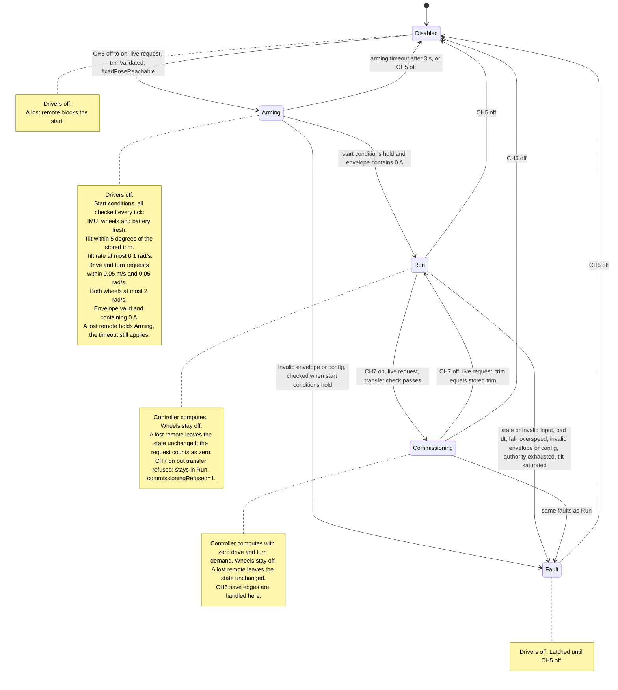

# Balance controller: states, switches, and safety rules

As of 2026-10-24 · firmware commit `776684b` · code in [BalanceController.h](../../../src/ES-02/OllieFOCdrive/BalanceController.h) and [BalanceController.cpp](../../../src/ES-02/OllieFOCdrive/BalanceController.cpp), glue in [OllieFOCdrive.ino](../../../src/ES-02/OllieFOCdrive/OllieFOCdrive.ino).

## What it does today

The controller is a state machine plus the control math. The sketch gives it measurements and the remote request on every control tick, and applies its output. **All control gains are 0 and the wheels are never driven.** The constant `kBalanceDrivesWheels` in the sketch is `false`, so in every state the wheels coast with the drivers off. The reason is in the [bench test note](../../../lab/robot/2026-10-24-balance-controller-first-bench-test.md): an enabled wheel at 0 A runs away.

What works and is tested on the robot: arming, run, fall detection, fault latching, remote loss, and the commissioning state with the trim knob and the save request.

## The five states

The sketch logs one `BALANCE state=<n> fault=<n> commissioningRefused=<0|1>` line whenever `state` or `fault` changes.

| `state` | Name | Meaning |
| --- | --- | --- |
| 0 | Disabled | Off. Drivers off, wheels free. Waits for CH5 to go from off to on. |
| 1 | Arming | CH5 went on. The controller checks the start conditions below. When they hold it goes to Run. After 3 s without success it returns to Disabled. |
| 2 | Run | Normal operation. The controller watches for faults. Wheels stay off (see above). |
| 3 | Commissioning | Standstill setup (CH7 on): trim adjustment and save request. Drive and turn requests are ignored. |
| 4 | Fault | A fault is latched. Drivers off. Only CH5 off leaves this state; the robot never restarts by itself. |

## State diagram

The start arrow marks the initial state, Disabled. The diagram follows `BalanceController::update()` in the code. CH5 off takes every state to Disabled and clears the fault. The request is live when the remote signal is fresh.

## Remote switches

| Channel | Function | Notes |
| --- | --- | --- |
| CH3 | Drive request | Forward stick = forward, up to the speed cap. Raw 992 is centre. |
| CH4 | Turn request | Left stick = left turn (positive yaw rate). |
| CH5 | Enable | Raw below 592 = off. 592 or above = on (positions 1 and 2 are both on). Only the change from off to on starts Arming. A position that is already on at boot, or when the remote reconnects, is ignored: flip CH5 off and on again. |
| CH6 | Save trim | Raw 992 or above = on. Only the change from off to on counts, and only in Commissioning. |
| CH7 | Commissioning | Raw 992 or above = on. Switch it on in Run to enter Commissioning, off to leave. |
| CH9 | Trim knob | Works only in Commissioning, with pickup (below). Raw 992 = trim 0, the end stops are plus and minus 3 degrees. |

## Start conditions (Arming to Run)

All of these must hold at the same time, checked on every tick during the 3 s window:

- IMU, wheel speeds, battery voltage, and the remote signal are fresh.
- Corrected roll is within 5 degrees of the stored trim (stored trim is 0 today).
- Tilt rate is at most 0.1 rad/s.
- Drive and turn sticks are within about 17 percent of centre (0.05 m/s and 0.05 rad/s).
- Both wheels turn at most 2 rad/s.
- The motor model is valid: valid battery range and a current envelope that contains 0 A.

Hold the robot upright and still before switching CH5 on. A lost remote signal blocks Arming too.

## Faults (state 4)

`fault` says why. All are checked every tick in Run and Commissioning; faults 8 and 9 can also latch in Arming once the start conditions hold.

| `fault` | Reason | Trigger |
| --- | --- | --- |
| 1, 2, 3 | Stale IMU, wheels, or battery | Timestamp older than 20 ms (battery 100 ms) |
| 4 | Invalid input | IMU or wheels flagged invalid, or a non-finite value |
| 5 | Time gap | Time between IMU samples is 0 or above 20 ms |
| 6 | **Fall** | Corrected roll beyond 35 degrees for 20 ms, same as the upstream project |
| 7 | Overspeed | A wheel above 60 rad/s for 50 ms |
| 8 | Invalid envelope | Battery out of range, non-finite value, or an inverted current range |
| 9 | Invalid config | A configuration value is unusable |
| 10 | Authority exhausted | The balance effort is limited for more than 2 s |
| 11 | Tilt saturated | The tilt reference is limited for more than 0.5 s |

CH5 off always returns to Disabled and clears the fault. In the sketch, a tripped wheel overspeed guard (60 rad/s for 50 ms) is read as CH5 off, so a runaway usually ends in Disabled instead of Fault 7; flip CH5 off and on to restart.

## Losing the remote

In Run and Commissioning the controller stays in its state. The request counts as zero, the trim is held, and balance would continue. In Disabled and Arming a lost remote blocks starting. When the remote returns, CH5 and CH6 are compared with their last live position: a switch that moved while the signal was lost does not start the robot and does not save.

## Commissioning and the trim

The trim is the small forward or backward lean that balances an uneven payload. It is set at standstill and then saved.

1. **Enter.** In Run, with sticks centred and the robot still, switch CH7 on. The controller refuses with `commissioningRefused=1` if a wheel moves, the tilt is off, the sticks are deflected, or any limit is active. Refusal changes nothing; the controller stays in Run.
2. **Adjust.** Turn CH9. The knob takes over only after its position passes the current trim (pickup), so nothing jumps. After that the trim follows the knob at up to 0.05 rad/s, limited to plus and minus 3 degrees. The trim is not logged and has no visible effect while the wheels are off.
3. **Save request.** Switch CH6 from off to on while in Commissioning. If the robot is still and the conditions hold, the log shows `save requested trim=<deg> deg; storage not wired`. Otherwise it shows `save refused; no pulse`. Nothing is stored yet: the trim storage is [package 6](../plans/robust-control-system.md#package-6-trim-storage). Switching CH7 off and on again does **not** request a save; only the CH6 edge does.
4. **Leave.** Switch CH7 off. The controller returns to Run only when the working trim equals the stored trim. After a changed, unsaved trim it stays in Commissioning until CH5 goes off.

## Measured signs

Checked on the robot on 2026-10-24:

| Movement | Reading | In the controller |
| --- | --- | --- |
| Lean forward | Roll falls, gyro x below 0 | Both are negated, so a forward lean is positive |
| Turn left | Gyro z rises | Left turn is a positive yaw rate |
| Turn a wheel forward | Wheel speed positive | Forward is positive |
| Forward drive current | Negative motor-local sign | Applied by `WheelBoundary::toMotorTargets()` |

## Not done yet

- **Driving the wheels.** Needs a safe 0 A behaviour first: SimpleFOC adds the estimated back-EMF as voltage, which accelerates the wheel on any KV error. The overspeed limit of 60 rad/s is also above the plateau at a low battery.
- **Gains, trim storage, scheduling** on the IMU rate, and **KV and resistance per wheel**.
- **The remaining starting values.** All `balanceConfig()` values marked `uncommissioned` in the sketch are proposals, not measured.
