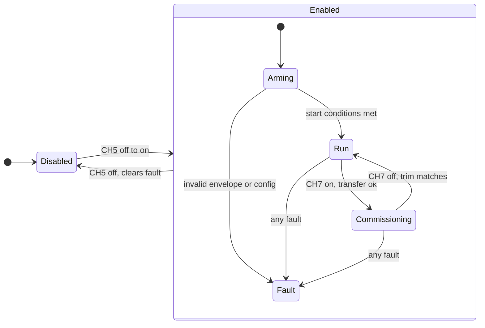

# Balance controller: states, switches, and safety rules

As of 2026-10-24 · firmware commit `776684b` · code in [BalanceController.h](../../../src/ES-02/OllieFOCdrive/BalanceController.h) and [BalanceController.cpp](../../../src/ES-02/OllieFOCdrive/BalanceController.cpp), glue in [OllieFOCdrive.ino](../../../src/ES-02/OllieFOCdrive/OllieFOCdrive.ino).

## What it does today

The controller is a state machine plus the control math. The sketch gives it measurements and the remote request on every control tick, and applies its output. Since 2026-10-24 the robot stands on its own on the ground. Gains in `balanceConfig()` (all uncommissioned starting values found by hand): tilt `tiltP` 8 A/rad, `gyroDamping` 0.4 A/(rad/s), yaw hold `yawP` 0.6 A/(rad/s), speed loop `speedKp` 0.25 rad per m/s and `speedKi` 0.08 rad per m, integral on. The leg servos are fixed at 20 degrees. After boot the commanded angle ramps from the assumed sag angle (10 degrees) to 20 degrees at 30 degrees per second (`stepLegPoseToward` in `LegPoseRamp.h`) after the motor calibration; Arming is not gated on the ramp. The wheel drivers are on in Run and Commissioning. The estimated back-EMF handed to SimpleFOC is the measured KV times `kWheelKvSafetyFactor` (1.8, a compile-time constant); without that margin an enabled wheel at 0 A runs away, see the [bench test note](../../../lab/robot/2026-10-24-balance-controller-first-bench-test.md). Disabled, Arming and Fault keep the drivers off and the wheels free.

What works and is tested on the robot: arming, run, fall detection, fault latching, remote loss, and the commissioning state with the trim knob and the save request.

## The five states

The sketch logs one `BALANCE state=<n> fault=<n> commissioningRefused=<0|1>` line whenever `state` or `fault` changes.

| `state` | Name | Meaning |
| --- | --- | --- |
| 0 | Disabled | Off. Drivers off, wheels free. Waits for CH5 to go from off to on. |
| 1 | Arming | CH5 went on. The controller checks the start conditions below. When they hold it goes to Run. After 3 s without success it returns to Disabled. |
| 2 | Run | Normal operation. The controller watches for faults and the wheel drivers are on at 0 A (a slight brake). |
| 3 | Commissioning | Standstill setup (CH7 on): trim adjustment and save request. Drive and turn requests are ignored. |
| 4 | Fault | A fault is latched. Drivers off. Only CH5 off leaves this state; the robot never restarts by itself. |

## State diagram

The start arrow marks the initial state, Disabled. The diagram follows `BalanceController::update()` in the code. CH5 off takes every state to Disabled and clears the fault. The request is live when the remote signal is fresh.

Disabled, Arming and Fault keep the drivers off. Run and Commissioning run the controller with the wheel drivers on; the output is 0 A while all gains are 0. `Enabled` groups the four states that need CH5 on.

- **Disabled to Arming** needs the CH5 edge with a live request, `trimValidated` and `fixedPoseReachable`, and no fault.
- **Arming to Run** needs every start condition in the [start conditions](#start-conditions-arming-to-run) section and an envelope that contains 0 A.
- **Arming** has no timeout in the firmware (`armingTimeoutUs = 0`); it waits until the start conditions hold or CH5 goes off.
- **Arming to Fault** on an invalid envelope or config, checked only while the start conditions hold.
- **Run to Commissioning** needs CH7 on and a live request; if the transfer check fails, the state stays in Run with `commissioningRefused=1`.
- **Commissioning to Run** needs CH7 off, a live request, `trimValidated` and a working trim equal to the stored trim.
- **Any fault** from Run or Commissioning goes to Fault: stale or invalid input, bad dt, fall, overspeed, invalid envelope or config, authority exhausted, tilt saturated (see the [faults](#faults-state-4) table).
- **Fall recovery**: with CH5 still on, a Fall fault clears and the controller re-enters Arming once the tilt stays inside the arming window around the stored trim for `fallRecoveryDelayUs` (0.5 s, uncommissioned) with a live request and fresh IMU. Arming then checks all its conditions before Run. Other faults stay latched until CH5 is cycled.
- **CH5 off** returns every state to Disabled and clears the fault.
- A lost remote leaves Run and Commissioning unchanged; the request counts as zero. It holds Arming.

## Remote switches

| Channel | Function | Notes |
| --- | --- | --- |
| CH3 | Drive request | Forward stick = forward, up to the speed cap. Raw 992 is centre. |
| CH4 | Turn request | Left stick = left turn (positive yaw rate). |
| CH5 | Enable | Three positions. 0 (raw below 592) = off. 1 (592 to 1401) = link mode: balance follows the link's `balance` action (signal `link_balance`), and the link drives with `Command`; see [Command](../../integration/software/ros2-uart-protocol.md#command). 2 (1402 and above) = RC balance on. Only the change from off to on in position 2 starts Arming. Position 2 that is already on at boot, or when the remote reconnects, is ignored: flip CH5 off and on again. |
| CH6 | Save trim | Raw 992 or above = on. Only the change from off to on counts, and only in Commissioning. |
| CH7 | Commissioning | Raw 992 or above = on. Switch it on in Run to enter Commissioning, off to leave. |
| CH9 | Trim knob | Works only in Commissioning, with pickup (below). Raw 992 = trim 0, the end stops are plus and minus 3 degrees. |

## Start conditions (Arming to Run)

All of these must hold at the same time, checked on every tick during the 3 s window:

- IMU, wheel speeds, battery voltage, and the remote signal are fresh.
- Corrected roll is within 5 degrees of the stored trim (stored trim is 0 today).
- Tilt rate is at most 0.1 rad/s.
- Drive and turn sticks are within about 17 percent of centre (0.05 m/s and 0.05 rad/s).
- Both wheels turn at most 2 rad/s.
- The motor model is valid: valid battery range and a current envelope that contains 0 A.

Hold the robot upright and still before switching CH5 on. A lost remote signal blocks Arming too.

## Faults (state 4)

`fault` says why. All are checked every tick in Run and Commissioning; faults 8 and 9 can also latch in Arming once the start conditions hold.

| `fault` | Reason | Trigger |
| --- | --- | --- |
| 1, 2, 3 | Stale IMU, wheels, or battery | Timestamp older than 20 ms (battery 100 ms) |
| 4 | Invalid input | IMU or wheels flagged invalid, or a non-finite value |
| 5 | Time gap | Time between IMU samples is 0 or above 20 ms |
| 6 | **Fall** | Corrected roll beyond 35 degrees for 20 ms, same as the upstream project |
| 7 | Overspeed | A wheel above 30 rad/s for 50 ms |
| 8 | Invalid envelope | Battery out of range, non-finite value, or an inverted current range |
| 9 | Invalid config | A configuration value is unusable |
| 10 | Authority exhausted | The balance effort is limited for more than 2 s |
| 11 | Tilt saturated | The tilt reference is limited for more than 0.5 s |

CH5 off always returns to Disabled and clears the fault. In the sketch, a tripped wheel overspeed guard (30 rad/s for 50 ms) is read as CH5 off, so a runaway usually ends in Disabled instead of Fault 7; flip CH5 off and on to restart.

## Losing the remote

In Run and Commissioning the controller stays in its state. The request counts as zero, the trim is held, and balance would continue. In Disabled and Arming a lost remote blocks starting. When the remote returns, CH5 and CH6 are compared with their last live position: a switch that moved while the signal was lost does not start the robot and does not save.

## Commissioning and the trim

The trim is the small forward or backward lean that balances an uneven payload. It is set at standstill and then saved.

1. **Enter.** In Run, with sticks centred and the robot still, switch CH7 on. The controller refuses with `commissioningRefused=1` if a wheel moves, the tilt is off, the sticks are deflected, or any limit is active. Refusal changes nothing; the controller stays in Run.
2. **Adjust.** Turn CH9. The knob takes over only after its position passes the current trim (pickup), so nothing jumps. After that the trim follows the knob at up to 0.05 rad/s, limited to plus and minus 3 degrees. The trim is not logged and has no visible effect while the wheels are off.
3. **Save request.** Switch CH6 from off to on while in Commissioning. If the robot is still and the conditions hold, the log shows `save requested trim=<deg> deg; storage not wired`. Otherwise it shows `save refused; no pulse`. Nothing is stored yet: the trim storage is [package 6](../plans/robust-control-system.md#package-6-trim-storage). Switching CH7 off and on again does **not** request a save; only the CH6 edge does.
4. **Leave.** Switch CH7 off. The controller returns to Run only when the working trim equals the stored trim. After a changed, unsaved trim it stays in Commissioning until CH5 goes off.

## Measured signs

Checked on the robot on 2026-10-24:

| Movement | Reading | In the controller |
| --- | --- | --- |
| Lean forward | Roll falls, gyro x below 0 | Both are negated, so a forward lean is positive |
| Turn left | Gyro z rises | Left turn is a positive yaw rate |
| Turn a wheel forward | Wheel speed positive | Forward is positive |
| Forward drive current | Negative motor-local sign | Applied by `WheelBoundary::toMotorTargets()` |

## Not done yet

- **Tuning.** The gains above are a hand-tuned set. Driving with the sticks works (turn rate cap 1.0 rad/s). Not tested: long runs and low battery.
- **Gains, trim storage, scheduling** on the IMU rate, and **KV and resistance per wheel**.
- **The remaining starting values.** All `balanceConfig()` values marked `uncommissioned` in the sketch are proposals, not measured.
