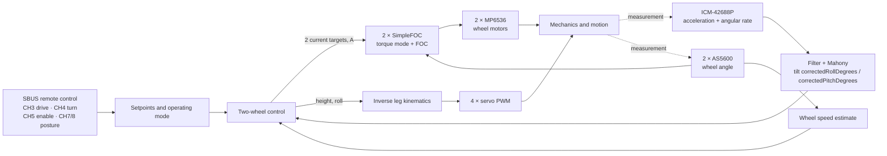

# Navbot-ES02 control: developer overview

As of 2026-10-08 · Based on the firmware in [OllieFOCdrive.ino](../../../src/ES-02/OllieFOCdrive/OllieFOCdrive.ino). This page explains the compiled **two-wheel / master mode** on the ESP32-S3. It describes the code, not automatically the state of a robot flashed later. Live-changed PID values are lost on restart.

## The idea in one sentence

The robot measures its tilt and drives both wheels to stay under its center of gravity. At the same time, four servos change the leg positions. A steering command produces different target speeds for the left and right wheel.

A **setpoint** is the desired behavior, and an **actual value** is the measurement. A PID controller computes a manipulated value from their difference. **P** reacts to the current error, **I** accumulates an error over time, and **D** reacts to its change. To understand this firmware, what matters is *which* manipulated value a controller actually changes.

## Signal flow in the active two-wheel mode

The IMU sits on the MAIN board according to the PCB draft. Each wheel motor has an AS5600 angle sensor on its own I²C bus. The motors are driven with three PWM phases, each through an MP6536. The four leg servos receive 50 Hz PWM. Sources: [Hardware overview](../hardware/system-overview.md), [Motors and encoders](../hardware/electronics-reference.md#motors-and-encoders), [Sensors](../hardware/electronics-reference.md#sensors-and-signals).

### Which controllers affect what?

| Branch | Error from setpoint and actual value | Result in the active two-wheel path |
| --- | --- | --- |
| **Tilt / balance** | `angleError = correctedRollDegrees + bodyPitchingFiltered` | No balance controller since Package 3 row 6; both wheel targets are 0 A. See the interim note below. `correctedRollDegrees` is called "roll" in the code. Here it is the attitude angle in degrees used for forward/backward tilting. |
| **Yaw / steering** | `yawError = attitude.gyro.z - bodyTurn` | `yawPid` supplies a differential part: wheel 1 gets `−yawOutput`, wheel 2 gets `+yawOutput`. The gyro Z value and the turn command are in rad/s. |
| **Drive / wheel speed** | none | The speed loop was removed in Package 3, row 2. CH3 is still parsed into `movementSpeed`, but no controller uses it. |
| **Ball pose** | CH9/10 | Changes `bodyPitching` and thereby indirectly the wheel or servo targets. See below. |

Core wheel motor logic: `target1 = angleOutput − yawOutput`, `target2 = angleOutput + yawOutput`. Both are then limited to ±88. The signs are software conventions and do not replace a test of the mechanical direction of action.

**Interim state (2026-10-22, Package 2):** the wheel motors now take ampere targets in torque mode, but the values above are still rad/s. `runPostureController()` therefore writes 0 A to both wheels after computing them. Balance does not drive the wheels until the Package 4 controller produces current commands. Package 3 and 4 remove or replace this path. See the [robust control plan](../plans/robust-control-system.md#package-2-motor-configuration-and-the-hardware-boundary). `runPostureController()` is the active two-wheel path. The unused older function `PIDcontroller_angle()` was removed during cleanup on 2026-10-01. It contained the classic cascade "speed → tilt → wheel motor", but `loop()` did not call it. The comment above `runPostureController()` also names a cascade, which is misleading at this point.

**Numerical example without I/D parts:** With `correctedRollDegrees=+1°`, `bodyPitchingFiltered=0`, and balance P=6, the P part adds `+6` to the common wheel target speed. If `yawError=+0.2 rad/s` and yaw P=5 are present at the same time, the yaw part is `+1`: wheel 1 receives `6−1=5`, and wheel 2 receives `6+1=7 rad/s`. The example shows the mixing calculation. The actual response depends on signs, dynamics, I/D parts, and limits.

### What happens on a drive command?

1. CH3 is mapped to `movementSpeed`. No controller reads it since the speed loop was removed.
2. The IMU supplies the tilt angle `correctedRollDegrees` via Mahony. No controller uses it since Package 3 row 6.
3. CH4 sets `bodyTurn`. The yaw controller compares it with `gyro.z` and raises one wheel target speed while lowering the other.
4. SimpleFOC receives each wheel's current target and computes the motor drive via FOC/PWM. Since Package 2 the motor mode is `torque` with `TorqueControlType::estimated_current`. The target in amperes is converted to `voltage.q = I · phase_resistance + back-EMF` and clamped to `voltage_limit` (4.2 V). The current is therefore an estimate, not a sensed value; the optional current sensing loops are compiled out. `current_limit` (about 0.73 A) is the derived stall current at the voltage ceiling, not a measured battery-current limit.

The behavior is coupled through the mechanics: a servo movement changes the position, and a wheel movement changes tilt and wheel speed. A tremor can therefore appear in both actuator groups, even when the trigger comes from only one branch.

## Inputs and additional functions

| Input | Effect in the current two-wheel code |
| --- | --- |
| **CH1** | Lateral posture request `bodyRoll` (effective in AUTO). |
| **CH2** | Leg height in standard/ball pose. In posture 1, a direct `bodyPitching` request. |
| **CH3** | Drive request `movementSpeed`, normally ±15. ×2 in the current diagnostic source state. |
| **CH4** | Turn request `bodyTurn`, range about ±11 rad/s after the sign reversal in the code. |
| **CH5** | 0: wheel setpoints zero, PID integrators reset. 1 and 2: both activate the same two-wheel control path with the same gains. |
| **CH6** | Posture: inverse leg kinematics. Mark: servo mounting/calibration position. |
| **CH7** | MANUAL/AUTO for lateral correction. AUTO also activates the `bodyPitching` path from CH9. |
| **CH8** | Standard, Pitching Adjust, Ball Pose. Ball Pose also activates `bodyPitching` from CH9. |
| **CH9/CH10** | Ball setpoints `topBallX/Y` of about ±5. CH9 can influence the tilt setpoint. |

**Important for comparisons:** `bodyPitching` is not explicitly set to zero everywhere in standard posture. After a mode change, a previous value in RAM can keep acting until it is overwritten or reset in the CH5-off path for `bodyPitchingFiltered`. For a test, log CH7/CH8/CH9 together.

SBUS is the only remote-control source and is read exactly once per loop.

## Timing, units and filters

- On every `loop()` pass, `motor.move()` and `motor.loopFOC()` run. The outer control block runs from `controlTimestepSec >= 0.001 s`. This is a **minimum threshold**, not a guaranteed 1 kHz rate. A stored standstill trace measured a median tick of about 1.66 ms. Under other load, it can differ. The 2026-10-22 voltage-sweep capture ([2 V log](../../../lab/robot/captures/2026-10-22-package1-t7-voltage-sweep-2v.log)) measured 424 loop passes per second, with a mean accepted IMU read interval of 2.36 ms (`imu_mean_interval_s` 0.002358 s). With the 1024-byte serial TX buffer (capture `lab/robot/captures/2026-10-22-package1-t10-after-tx-buffer.log`, wheels clear, balance off) the loop runs about 521 passes per second, the mean accepted IMU interval is 1.92 ms, and the maximum loop-entry interval is 2.5 ms instead of 7.3 ms. The remaining pass time of about 1.9 ms is not profiled, so the outer control block still does not run at 1 kHz.
- The IMU is read over SPI in the main pass. Acceleration and gyro are low-pass filtered and fused with Mahony into the attitude angle. The yaw controller uses `attitude.gyro.z`, which is the scaled raw gyro value, not `gyrof.z`.
- Since Package 2 (2026-10-22), the wheel speed is computed as encoder angle difference divided by the **measured interval between encoder reads** (`micros()`), in both live-tuning states, then smoothed with a SimpleFOC low-pass filter. It is forward-positive; the motor sign is applied only in `WheelBoundary`. Before this change, the divisor was the control tick only with `DIAGNOSTIC_LIVE_TUNING_DEFAULTS`, and a fixed `0.01 s` otherwise. That scaled the speed too small by about 5.6 at a 1.8 ms tick, so gains from the two states were not comparable.
- `correctedRollDegrees`/`correctedPitchDegrees` are angles in degrees after subtracting stored zero points. The gyro supplies rad/s. `bodyX` is a kinematic shift in meters. The wheel targets are SimpleFOC target speeds in rad/s. The named PID gains therefore carry different implicit units. Numbers from different controllers cannot be compared directly.

### Biquad filters and sample rates

`biquadFilterInitLPF(filter, cutoffHz, samplingRateHz)` expects the cutoff frequency and the sampling rate in Hz. The function computes `omega = 2π · cutoffHz / samplingRateHz`. The earlier calculation wrongly treated the sampling rate as a period in microseconds. In diagnostic mode, `diagnosticLoop()` calls `imu::service()` nominally every 10 ms. The IMU filters are designed there for a 20 Hz cutoff and a 100 Hz sampling rate.

In normal mode, `loop()` calls `imu::service()` on every pass via `readInputs()`. `imu::kSampleRateHz` is the fixed constant 1000. It determines the IMU filter coefficients and the sensor ODR. The value does not clock any measurement. `MahonyFilter::update()` receives the filtered gyro and acceleration values and the measured `dtSec`. The source code does not establish a fixed IMU sample rate or an exact frequency response under load. The firmware recomputes the filter coefficients only when the cutoff frequencies change, not on every sample.

In normal mode, the battery, remote-control, and PID output filters run in the outer control block, as soon as `controlTimestepSec` is at least 1 ms. Their sampling rate of 1000 Hz is a nominal design value. The guard does not guarantee a fixed rate of 1 kHz. An existing standstill trace measured a median of about 1.66 ms per tick. Other load can change this value. In the 2026-10-22 voltage-sweep capture the measured rate was 424 loop passes per second, about 0.42 of the nominal 1000 Hz. By calculation, a biquad designed for 1000 Hz then has its cutoff at roughly 0.42 times the design value; this is not a measured frequency response. After the TX buffer change the measured rate is about 521 passes per second (see above), not 1 kHz.

In normal mode, the battery filter now uses a cutoff of 50 Hz and a nominal sampling rate of 1000 Hz. In diagnostic mode it uses 20 Hz and 100 Hz; there the measurement runs every 10 ms. The corrected coefficients make the battery filter react faster to voltage changes in both modes than before. The diagnostic Mahony fusion receives the intended 20 Hz IMU filters instead of an effective limit around 0.2 Hz. The coefficients of the normal IMU filter remain at the start values of 50 Hz and 1000 Hz. The actual IMU sample rate, however, is not measured.

On 2026-10-07, a motor-free diagnostic run delivered 250 complete CSV lines. All lines reported `imu_ok=1`. The 249 time intervals lay between 9.966 and 10.040 ms. The median was 10.000 ms. No interval exceeded 15 ms. In the same stationary recording, the standard deviation of the filtered gyro X signal was 0.641 of the unfiltered standard deviation. For acceleration Z, the ratio was 0.733. The raw battery voltage ranged from 7.250077 to 7.307390 V, and the filtered voltage from 7.262542 to 7.293375 V.

This recording confirms the diagnostic telemetry clock and stationary smoothing. It is not a controlled frequency response test. Proving the 20 Hz cutoff requires a known mechanical excitation with a measured input-output amplitude, which is missing. The actual IMU sample rate in normal control mode also remains unmeasured.

## Current parameters: start values and CH5 modes

`DIAGNOSTIC_LIVE_TUNING_DEFAULTS=1` is currently set in the local sketch. At start, the firmware loads the balance gain set, overrides parts of it, and leaves live tuning enabled. This also applies after briefly cycling CH5=1. The start set matches the live values read back on 2026-10-01, with which the user no longer reported vibration. Later serial changes remain valid until restart and do not change this start set.

| Quantity | Current diagnostic start value | CH5=1 or CH5=2 |
| --- | ---: | ---: |
| Balance P / I / D | 5 / 200 / 0.11 | 5 / 200 / 0.11 |
| Balance integral state limit | ±0.1 | ±0.1 |
| Speed P / I / D, before `/100` | 0.045 / 0.005 / 0 | 0.045 / 0.005 / 0 |
| Yaw P / I / D | 4 / 0 / 0 | 4 / 0 / 0 |
| CH3 mapping | ±15 × 2 | ±15 |

The yaw I start value is zero in both CH5 modes. The ±0.1 limit is the limit of the **balance integral state**, not of the motor target. With I=200, it yields a maximum contribution of ±20. P and D can supply further parts. The motor target itself is limited to ±88. The speed coefficients are divided by 100 in `runPostureController()` before `speedPid` uses them. Serial commands such as `PP5`, `PD0.12`, `SP0.04` change the values only until restart. The source and the flashed image must be reconciled before measurement comparisons.

## Enable and protection in the code

- CH5=0 or a detected fall: wheel setpoints zero, `bodyX` and the PID integrators reset. SimpleFOC keeps running. "Setpoint zero" here does not mean the output stage is switched off.
- `updateTumbleState()` sets the fall flag after 20 consecutive control calls with `|correctedRollDegrees| >= 35°`. To re-enable, the angle must be `<= 5°` again and the internal counter must count back down. The time depends on the real control rate.
- The battery voltage comes via GPIO17 from the **2S battery line**, not from the 3.3 V rail. Below 7.4 V, the status LED blinks faster, and the firmware logs a warning at most once per second in the control loop. There is no shutdown. A voltage dip can have further hardware effects, but this threshold does not actively prevent them.
- `readSbus()` sets `movementSpeed` and `bodyTurn` to zero if no valid frame has arrived for more than 100 ms or `sBus.Failsafe()` does not report OK. The switch modes and the body height, pitch, and roll commands keep their last received value. The robot continues balancing in place.
- The gyro calibration (`E1`) blocks the control loop for several seconds. It is refused while balance is active (CH5 on and not fallen). `calibrationSelect` is reset to 0, and `gyro calibration refused: balance active` is logged.

## Where developers should look

| Question | Code / documentation location |
| --- | --- |
| Hardware, connectors, evidence level | [Hardware overview](../hardware/system-overview.md), [Electronics reference](../hardware/electronics-reference.md) |
| Start configuration, SimpleFOC, gains | `OllieFOCdrive.ino`: defines at the top, `setup()`, `applyPidParameters()` |
| Active flow, enable, servo output | `OllieFOCdrive.ino`: `loop()` |
| Two-wheel PID and motor mixing | `OllieFOCdrive.ino`: `runPostureController()` |
| Remote control and modes | `OllieFOCdrive.ino`: `readSbus()` |
| IMU fusion and posture offsets | `imu.cpp`: `imu::service()`; `MahonyFilter.cpp` |
| PID calculation rule | `OllieFOCdrive.h`: `MyPIDController::compute()` |
| Leg kinematics | `LegKinematics.cpp`: `LegKinematics::solveRight()`, `solveLeft()` |
| Calibration and storage | `Calibration.cpp`, `CalibrationStore.cpp`; call in `OllieFOCdrive.ino`: `loop()` |
| Servo output | `ServoControl.cpp`; trims in `zeroBias.servo1` through `zeroBias.servo4` |
| K58 drive trace with controller parts | [README](trace-capture.md#capture-a-balance-shutdown), `scripts/capture_balance_trace.py` |

### Not yet resolved

The existing drive traces show overrun and occasional counter-rolling after CH3=0. User observations also report tilt tremor after drive maneuvers. The balance I part reached ±22.2 in one trace. This is a plausible contribution, but not a proven sole cause. Different trials had different starting tilts and command pulses. Supply dips were also observed, without motor current and servo current being measured separately. For a causal statement, the flashed state, live gains, switch positions, `controlTimestepSec`, wheel measurement, IMU angle, PID parts, motor targets, and voltage must all match within the same trial.
