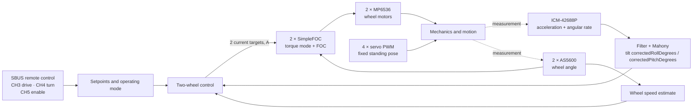

# Navbot-ES02 control: developer overview

As of 2026-10-26 · Based on the firmware in [OllieFOCdrive.ino](../../../src/ES-02/OllieFOCdrive/OllieFOCdrive.ino). This page explains the compiled **two-wheel / master mode** on the ESP32-S3. It describes the code, not automatically the state of a robot flashed later. Live-changed PID values are lost on restart.
> The states, remote switches, faults, and commissioning of the balance controller are described in [Balance controller](balance-controller.md). This page gives the overview of the signal flow.

## The idea in one sentence

The robot measures its tilt and drives both wheels to stay under its center of gravity. At the same time, four servos change the leg positions. A steering command produces different target speeds for the left and right wheel.

A **setpoint** is the desired behavior, and an **actual value** is the measurement. A PID controller computes a manipulated value from their difference. **P** reacts to the current error, **I** accumulates an error over time, and **D** reacts to its change. To understand this firmware, what matters is *which* manipulated value a controller actually changes.

## Signal flow in the active two-wheel mode

The IMU sits on the MAIN board according to the PCB draft. Each wheel motor has an AS5600 angle sensor on its own I²C bus. The motors are driven with three PWM phases, each through an MP6536. The four leg servos receive 50 Hz PWM. Sources: [Hardware overview](../hardware/system-overview.md), [Motors and encoders](../hardware/electronics-reference.md#motors-and-encoders), [Sensors](../hardware/electronics-reference.md#sensors-and-signals).

### Which controllers affect what?

The sketch runs one `BalanceController` (a state machine plus the control math, see [Balance controller](balance-controller.md)). On every control tick it receives the tilt and tilt rate from the IMU, the wheel speeds, the bus voltage, and the remote request. It returns a current for each wheel and the drive enable. The wheel current comes from a tilt term, gyro damping, a yaw-rate term, and a speed loop that moves the tilt reference. Per-wheel current envelopes limit the output. The old speed PI to `bodyX`, the roll and ball controllers, and the touchscreen and Bluetooth paths were removed. The legs hold the fixed standing pose (every servo at the same angle, trims do not apply, no inverse kinematics).

### What happens on a drive command?

1. CH3 sets the speed request (`request.speedMps`, forward is positive, up to `speedCapMps`, 0.3 m/s). The controller shapes it with acceleration and brake limits, and the speed loop turns the speed error into a tilt reference.
2. The IMU supplies the tilt angle via Mahony. The controller latches a Fall fault when the tilt stays beyond 35 degrees for 20 ms.
3. CH4 sets the yaw-rate request (left is positive, up to `yawRateCapRadPerSec`, 1.0 rad/s). The yaw term turns the difference to the gyro Z rate into a differential wheel current.
4. SimpleFOC receives each wheel's current target and computes the motor drive via FOC/PWM. Since Package 2 the motor mode is `torque` with `TorqueControlType::estimated_current`. The target in amperes is converted to `voltage.q = I · phase_resistance + back-EMF` and clamped to `voltage_limit` (4.2 V). The current is therefore an estimate, not a sensed value; the optional current sensing loops are compiled out. `current_limit` (about 0.73 A) is the derived stall current at the voltage ceiling, not a measured battery-current limit.

The behavior is coupled through the mechanics: a servo movement changes the position, and a wheel movement changes tilt and wheel speed. A tremor can therefore appear in both actuator groups, even when the trigger comes from only one branch.

## Inputs and additional functions

| Input | Effect in the current two-wheel code |
| --- | --- |
| **CH1, CH2** | Unused (body roll, leg height, and pitch were removed). |
| **CH3** | Speed request, forward stick positive, scaled to plus and minus 0.3 m/s. Ignored in Commissioning. |
| **CH4** | Yaw-rate request, left stick positive, scaled to plus and minus 1.0 rad/s. |
| **CH5** | Enable. Raw below 592 is off; 592 or above is on. Only the change from off to on starts Arming; off takes every state to Disabled and clears a fault. |
| **CH6** | Save request for the trim (raw 992 or above), only in Commissioning. |
| **CH7** | Commissioning (raw 992 or above). |
| **CH8, CH10** | Unused. |
| **CH9** | Trim knob, plus and minus 3 degrees, only in Commissioning. |

SBUS is the only remote-control source and is read exactly once per loop.

## Timing, units and filters

- On every `loop()` pass, `motor.move()` and `motor.loopFOC()` run. The outer control block runs from `controlTimestepSec >= 0.001 s`. This is a **minimum threshold**, not a guaranteed 1 kHz rate. A stored standstill trace measured a median tick of about 1.66 ms. Under other load, it can differ. The 2026-10-22 voltage-sweep capture ([2 V log](../../../lab/robot/captures/2026-10-22-package1-t7-voltage-sweep-2v.log)) measured 424 loop passes per second, with a mean accepted IMU read interval of 2.36 ms (`imu_mean_interval_s` 0.002358 s). With the 1024-byte serial TX buffer (capture `lab/robot/captures/2026-10-22-package1-t10-after-tx-buffer.log`, wheels clear, balance off) the loop runs about 521 passes per second, the mean accepted IMU interval is 1.92 ms, and the maximum loop-entry interval is 2.5 ms instead of 7.3 ms. The remaining pass time of about 1.9 ms is not profiled, so the outer control block still does not run at 1 kHz.
- On 2026-10-26 the DRIVE telemetry measured a median control tick of about 1.37 ms and an IMU accepted-read rate of 680 Hz, while the IMU outputs 1 kHz. See [the roadmap item](../plans/roadmap.md#speed-up-the-main-loop-pass).
- The IMU is read over SPI in the main pass. Acceleration and gyro are low-pass filtered and fused with Mahony into the attitude angle. The yaw controller uses `attitude.gyro.z`, which is the scaled raw gyro value, not `gyrof.z`.
- The wheel speed is computed as encoder angle difference divided by the **measured interval between encoder reads** (`micros()`), in every state, then smoothed with a SimpleFOC low-pass filter. It is forward-positive; the motor sign is applied only in `WheelBoundary`.
- `correctedRollDegrees`/`correctedPitchDegrees` are angles in degrees after subtracting stored zero points. The gyro supplies rad/s. The wheel targets are amperes in torque mode, set by the balance controller.

### Biquad filters and sample rates

`biquadFilterInitLPF(filter, cutoffHz, samplingRateHz)` expects the cutoff frequency and the sampling rate in Hz. The function computes `omega = 2π · cutoffHz / samplingRateHz`. The earlier calculation wrongly treated the sampling rate as a period in microseconds. In diagnostic mode, `diagnosticLoop()` calls `imu::service()` nominally every 10 ms. The IMU filters are designed there for a 20 Hz cutoff and a 100 Hz sampling rate.

In normal mode, `loop()` calls `imu::service()` on every pass via `readInputs()`. `imu::kSampleRateHz` is the fixed constant 1000. It determines the IMU filter coefficients and the sensor ODR. The value does not clock any measurement. `MahonyFilter::update()` receives the filtered gyro and acceleration values and the measured `dtSec`. The source code does not establish a fixed IMU sample rate or an exact frequency response under load. The firmware recomputes the filter coefficients only when the cutoff frequencies change, not on every sample.

In normal mode, the battery filter runs in the outer control block, as soon as `controlTimestepSec` is at least 1 ms. Their sampling rate of 1000 Hz is a nominal design value. The guard does not guarantee a fixed rate of 1 kHz. An existing standstill trace measured a median of about 1.66 ms per tick. Other load can change this value. In the 2026-10-22 voltage-sweep capture the measured rate was 424 loop passes per second, about 0.42 of the nominal 1000 Hz. By calculation, a biquad designed for 1000 Hz then has its cutoff at roughly 0.42 times the design value; this is not a measured frequency response. After the TX buffer change the measured rate is about 521 passes per second (see above), not 1 kHz.

In normal mode, the battery filter now uses a cutoff of 50 Hz and a nominal sampling rate of 1000 Hz. In diagnostic mode it uses 20 Hz and 100 Hz; there the measurement runs every 10 ms. The corrected coefficients make the battery filter react faster to voltage changes in both modes than before. The diagnostic Mahony fusion receives the intended 20 Hz IMU filters instead of an effective limit around 0.2 Hz. The coefficients of the normal IMU filter remain at the start values of 50 Hz and 1000 Hz. The actual IMU sample rate, however, is not measured.

On 2026-10-07, a motor-free diagnostic run delivered 250 complete CSV lines. All lines reported `imu_ok=1`. The 249 time intervals lay between 9.966 and 10.040 ms. The median was 10.000 ms. No interval exceeded 15 ms. In the same stationary recording, the standard deviation of the filtered gyro X signal was 0.641 of the unfiltered standard deviation. For acceleration Z, the ratio was 0.733. The raw battery voltage ranged from 7.250077 to 7.307390 V, and the filtered voltage from 7.262542 to 7.293375 V.

This recording confirms the diagnostic telemetry clock and stationary smoothing. It is not a controlled frequency response test. Proving the 20 Hz cutoff requires a known mechanical excitation with a measured input-output amplitude, which is missing. The actual IMU sample rate in normal control mode also remains unmeasured.

## Current parameters: start values and CH5 modes

No balance gains are active. Package 4 defines the new gain set.

## Enable and protection in the code

- CH5=0 or a detected fall: wheel setpoints zero. SimpleFOC keeps running. "Setpoint zero" here does not mean the output stage is switched off.
- `updateTumbleState()` sets the fall flag after 20 consecutive control calls with `|correctedRollDegrees| >= 35°`. To re-enable, the angle must be `<= 5°` again and the internal counter must count back down. The time depends on the real control rate.
- The battery voltage comes via GPIO17 from the **2S battery line**, not from the 3.3 V rail. Below 7.4 V, the status LED blinks faster, and the firmware logs a warning at most once per second in the control loop. There is no shutdown. A voltage dip can have further hardware effects, but this threshold does not actively prevent them.
- `readSbus()` sets `movementSpeed` and `bodyTurn` to zero if no valid frame has arrived for more than 100 ms or `sBus.Failsafe()` does not report OK. The CH5 switch keeps its last received value. The robot holds 0 A on both wheels.
- The gyro calibration (`E1`) blocks the control loop for several seconds. It is refused while balance is active (CH5 on and not fallen). `calibrationSelect` is reset to 0, and `gyro calibration refused: balance active` is logged.

## Where developers should look

| Question | Code / documentation location |
| --- | --- |
| Hardware, connectors, evidence level | [Hardware overview](../hardware/system-overview.md), [Electronics reference](../hardware/electronics-reference.md) |
| Start configuration, SimpleFOC, gains | `OllieFOCdrive.ino`: defines at the top, `setup()` |
| Active flow, enable, servo output | `OllieFOCdrive.ino`: `loop()` |
| Wheel targets and fixed servo pose | `OllieFOCdrive.ino`: `runControlTick()` |
| Remote control and modes | `OllieFOCdrive.ino`: `readSbus()` |
| IMU fusion and posture offsets | `imu.cpp`: `imu::service()`; `MahonyFilter.cpp` |
| Calibration and storage | `Calibration.cpp`, `CalibrationStore.cpp`; call in `OllieFOCdrive.ino`: `loop()` |
| Servo output | `ServoControl.cpp`; trims in `servoTrims`, set through the parameters `servo1_trim` to `servo4_trim` ([navlink](../../integration/software/navlink.md)) |
| Drive trace with controller parts | [trace capture](trace-capture.md#analyse-a-drive-trial), `navlink capture --preset drive` |

### Not yet resolved

The existing drive traces show overrun and occasional counter-rolling after CH3=0. User observations also report tilt tremor after drive maneuvers. The balance I part reached ±22.2 in one trace. This is a plausible contribution, but not a proven sole cause. Different trials had different starting tilts and command pulses. Supply dips were also observed, without motor current and servo current being measured separately. For a causal statement, the flashed state, live gains, switch positions, `controlTimestepSec`, wheel measurement, IMU angle, PID parts, motor targets, and voltage must all match within the same trial.
