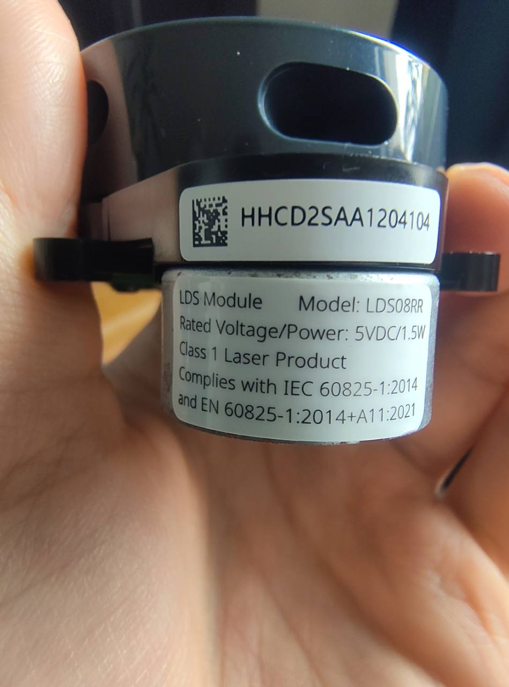
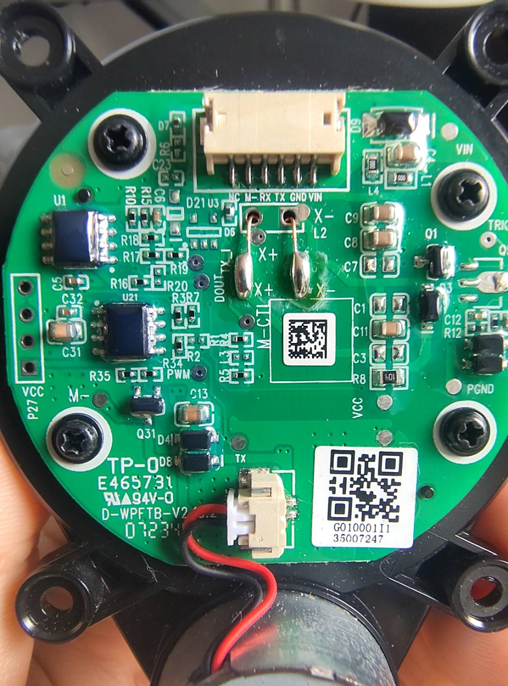

# LDS08RR LiDAR

## Scope and status

The LDS08RR is the module selected for ros2_pc LiDAR software. User-supplied photographs received on 13 October 2026 confirm the model marking and the PCB markings below. The software has a demo page, serial reader, and ROS 2 publisher. No live sensor capture or electrical acceptance has been completed. See the [LiDAR software steps](../software/README.md#lds08rr-lidar) and the [ros2_pc roadmap](../ROS_ROADMAP.md#2-roborock-lidar-in-ros-2-integrieren).

## Module label

The [label photograph](images/lds08rr-label.jpg) shows these markings on this module:

| Item | Printed marking |
| --- | --- |
| Model | `LDS08RR` |
| Rated voltage and power | `5VDC/1.5W` |
| Laser classification | `Class 1 Laser Product` |
| Compliance statement | `IEC 60825-1:2014` and `EN 60825-1:2014+A11:2021` |
| Separate identification label | `HHCD2SAA1204104` |

The rated power divided by the rated voltage gives 0.30 A. This is a calculation from the label, not a measurement or a startup, stall, or peak-current limit. The laser classification and compliance statement are label claims, not independent certification checks.

## Connector and PCB markings

The [PCB photograph](images/lds08rr-pcb.jpg) shows a six-contact connector at the top of the image. In that exact view, with the silkscreen text upright and the contacts below the connector body, the printed labels run left to right as follows. The numbers below describe photo positions only; they are not manufacturer pin numbers.

| Photo position | Silkscreen | Verification status |
| ---: | --- | --- |
| 1, leftmost | `NC` | Marking only; internal connection unverified |
| 2 | `M−` | Active low; user reports 1 mA when pulled to GND on 14 October 2026 |
| 3 | `RX` | Likely module receive signal by naming; direction and voltage unmeasured |
| 4 | `TX` | Likely module transmit signal by naming; direction and voltage unmeasured |
| 5 | `GND` | Lidar Ground |
| 6, rightmost | `VIN` | Supply input, 500mA max., 230mA measured with Motor ON. |

A mating plug viewed from its cable side reverses the apparent order. Connector series, pitch, and pin-1 convention are not established by the photograph. `NC` is not an available GPIO assignment. `M−` does not by itself establish a PWM input or a motor-power connection.

The board also has `PWM`, `M−`, `M−CT`, `VCC`, `VIN`, `PGND`, and `TX` markings. A separate two-contact connector carries red and black wires near the motor. Neither wire colour nor these markings establish a complete circuit or wiring diagram. The photo shows four outer mounting ears and a circular PCB. Hole spacing and side-view dimensions come from a user sketch, recorded in the [mechanical dimensions section](#mechanical-dimensions), and are not independently measured. Screw sizes and scan-plane height remain unknown.

## Mechanical dimensions

The [dimension record](mechanics/lds08rr-dimensions.json) and [mounting-hole drawing](mechanics/lds08rr-lochbild.svg) transcribe user-supplied dimensioned sketches received on 13 October 2026: the [mounting sketch](images/lds08rr-mounting-sketch.jpg), the [side-view sketch](images/lds08rr-side-sketch.jpg), and a later [combined side and top-view sketch](images/lds08rr-dimension-sketch.jpg) with follow-up answers from the user. The values are not independently measured.

- Four Ø 3.1 mm mounting holes form a rectangle with 54.0 mm horizontal and 44.0 mm vertical centre spacing, as read from the mounting sketch. The sketch gives a 69.4 mm diagonal; a 54 × 44 mm rectangle implies 69.66 mm. Rectangularity is not measured.
- The rotor centre coincides with the centre of the hole pattern, as confirmed by the user.
- Heights from the bottom of the lower round housing: 17.8 mm to the underside of the plastic plate and 28.0 mm to its top, which carries the PCB. The plate is therefore 10.2 mm thick. The overall height to the top of the motor is 38.0 mm.
- The mounting ears are 4.3 mm thick, with their top flush with the plate top.
- Widths: lower housing 59.0 mm, plate Ø 59.6 mm (top view), and motor 24.5 mm. The outer edge of the motor is 50.0 mm from the rotor centre, and the overall length is 80.9 mm.

Coordinates use the hole-pattern centre as origin, viewed from the PCB side with the motor on the left. Tolerances, hole depth, fastener type, optical-axis offset, and scan-plane height remain unspecified.

### Simplified 3D model

[lds08rr-simple.step](mechanics/lds08rr-simple.step) is a simplified envelope of the module for measurements, such as bracket design and clearance checks. The build123d source is [lds08rr_simple.py](mechanics/lds08rr_simple.py). To regenerate the STEP file, run the script from the `mechanics/` folder.

The model origin is the rotor centre. z = 0 is the bottom of the lower housing, and +z points toward the PCB and motor. It models the housing (Ø 59.0 mm, z 0 to 17.8 mm), the plate (Ø 59.6 mm plus the area under the motor, z 17.8 to 28.0 mm), the ears (z 23.7 to 28.0 mm), and the motor (Ø 24.5 mm, axis at x = −37.75 mm, z 28.0 to 38.0 mm). The connector, PCB components, and true ear outline are not modelled; the 7 mm ear width is assumed. The housing is modelled concentric with the rotor. As a result, the model is 80.5 mm long instead of the sketched 80.9 mm. The sketched 59.0 mm housing width, combined with the 80.9 mm overall length, would put the housing centre about 1.4 mm off the rotor axis.

## Upstream protocol variants

The [kaiaai LDS library](https://github.com/kaiaai/LDS) identifies LDS08RR as Revo LDS used in Roborock and the 3irobotix CRL-200S platform. Its documentation distinguishes Delta framing from a Camsense-family revision. That identification does not prove which revision is shown in this project's photographs.

The [lds2d model table](https://github.com/kaiaai/lds2d#supported-models) gives the following software-reference configurations. Both LDS08RR entries are marked as ports not yet confirmed on physical hardware by that project.

| Upstream variant | Arduino LDS identifier | lds2d identifier | UART baud rate | Framing | Upstream motor classification |
| --- | --- | --- | ---: | --- | --- |
| Delta | `LDS_LDS08RR` | `3IROBOTIX-LDS08RR` | 115200 | `0xAA` | Host PWM |
| Camsense family | `LDS_LDS08RR_CAMSENSE` | `LDS08RR-CAMSENSE` | 115200 | `0x55 0xAA` | Onboard |

Sources for the identifiers and framing are the [LDS README](https://github.com/kaiaai/LDS#experimental-needs-testing). Baud rates and motor classifications come from the [lds2d README](https://github.com/kaiaai/lds2d#supported-models). These are driver assumptions, not verified electrical specifications for this module.

The Camsense support derives from a user's capture in [LDS issue 17](https://github.com/kaiaai/LDS/issues/17) and remains experimental in the LDS library. That capture belongs to another device. A capture from this module is still needed to establish its protocol. LDS01RR, LDS02RR, and LDROBOT LD08 specifications are not interchangeable with LDS08RR specifications.

## Pending electrical and mechanical verification

The proposed J8 connection is listed below; physical wiring remains unverified. A direct UART or USB-to-UART connection depends on confirmed connector mapping and signal voltages. The labelled 5 V supply rating does not establish 5 V UART logic. A connection requires verified ground continuity and a supply arrangement that avoids backfeeding another source.

The Delta software driver normally activates host PWM. This integration injects an inert motor output, so it never toggles a GPIO or PWM pin. The Camsense driver has no host motor output. Neither driver choice proves which protocol or motor circuit this module uses. The connector's `M−` active-low polarity and 1 mA current when pulled to GND are user-reported measurements above. Its open-circuit voltage, logic thresholds, waveform, motor voltage, and total motor current still need measurement before a sink circuit is selected.

The remaining hardware record needs:

- Connector identification, continuity checks, UART logic levels, and any required input signals.
- Operating, startup, and stall current, plus the actual motor-control circuit.
- A raw serial capture identifying framing, scan rate, distance units, and invalid measurements.
- Range, accuracy, optical clearance, independently measured dimensions and mounting-hole spacing, and scan-plane alignment for this module.

The software publishes `sensor_msgs/msg/LaserScan` on `/scan` and diagnostics on `/lidar/status`. Its 360 one-degree bins preserve the nearest valid return in metres and use positive infinity for missing returns. The range limits of 0.01 m and 30 m are provisional software bounds, not measured LDS08RR limits. Angle zero and rotation direction follow the driver output and remain uncalibrated. The scan timestamp estimates scan start by subtracting one reported rotation period from host receive completion time.

## Planned ros2_pc connection

Reserve UART2 on the Compute Module 5 J8 header. GPIO4 is UART2 TX on physical pin 7. GPIO5 is UART2 RX on physical pin 29. Connect LiDAR TX to pin 29 only after measuring the signal level. Leave LiDAR RX disconnected unless a captured protocol shows that the host must send commands. Use J8 pin 4 for the module's 5 V input and pin 6 for ground only after checking the carrier supply path and current budget.

The Compute Module 5 used for software checks reported model `Raspberry Pi Compute Module 5 Rev 1.0` and Ubuntu 24.04.5. At the time of inspection, `/dev/ttyAMA0` and `/dev/ttyAMA10` existed, `/dev/ttyAMA2` did not, and `/boot/firmware/config.txt` had no UART2 overlay. `pinctrl get 4-5` showed GPIO4 and GPIO5 with no alternate function. GPIO14 and GPIO15 were assigned to UART0. The installed overlay documentation lists `dtoverlay=uart2-pi5` for UART2 GPIO4 and GPIO5. These checks establish the software host's current pin mux and overlay availability. They do not establish the sensor wiring or the device name after enabling UART2.

Do not edit the boot configuration or connect the module as part of software setup. After the supply, ground, connector mapping, and UART voltage levels are confirmed, add `dtoverlay=uart2-pi5` to `/boot/firmware/config.txt` and reboot the Compute Module 5. Check the pin mux with `pinctrl get 4-5`. Then inspect `/dev/ttyAMA*` and confirm which device maps to UART2 on that image before passing it to the launcher. Do not assume that UART2 is `/dev/ttyAMA2` from its UART number alone.

Reserve J8 pin 11 (GPIO17) for a possible future external sink that controls `M−`. Do not connect `M−` directly to GPIO17 or add a transistor until you measure its idle voltage, logic thresholds, and drive requirements. No boot overlay, GPIO output, or motor-control code activates this pin.

The selected protocol remains unverified. Choose `delta` or `camsense` explicitly from a capture made from this module. The software does not auto-detect or switch protocols.

## Evidence

The two original user photographs above are the local evidence for the label, connector markings, and visible layout. Upstream driver documentation was checked on 13 October 2026. No LDS08RR manufacturer pinout or mechanical drawing was verified during this documentation task.
